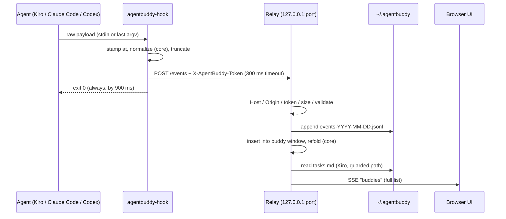

# Design: Core Pipeline

## Overview

One event travels this path:



All decisions live in `src/core` as pure functions. The hook, relay and UI are thin shells around them: the hook does stdin/argv and one HTTP call, the relay does files, HTTP and a clock tick, and the UI does the DOM.

## Architecture

```
src/core     config  event  text  normalize  history  state  buddies  progress
               ▲        ▲      ▲       ▲          ▲       ▲       ▲
src/hook     cli ──────────────────────┘ (normalize, truncate via normalize, config)
src/relay    main → home, store (history, state), server (event), stream, tasks (progress)
src/ui       main → screens/list   (imports core types only)
```

- `src/core` imports nothing outside `src/core` and no Node built-ins, so the UI and the later demo build can bundle it for the browser.
- Only `src/hook` and `src/relay` use `node:fs`, `node:http`, `node:os`, `node:crypto`. Only `src/ui` touches the DOM.

## Components and interfaces

### `src/core/config.ts`
Shared constants, so the hook, relay and tests never disagree.

```ts
export const DEFAULT_PORT = 4343;
export const TEXT_LIMIT = 120;              // code points
export const WINDOW_SIZE = 50;              // events per session
export const IDLE_AFTER_MS = 10 * 60_000;
export const OFFLINE_AFTER_MS = 30 * 60_000;
export const HOOK_LIMITS = { stdinWaitMs: 500, postTimeoutMs: 300, hardExitMs: 900, maxStdinBytes: 1_048_576, maxErrorLogBytes: 1_048_576 };
export const RELAY_LIMITS = { maxBodyBytes: 16_384, tickMs: 30_000, heartbeatMs: 25_000, maxTasksFileBytes: 1_048_576, restoreWindowMs: 24 * 3_600_000 };
export const HOME_DIR = '.agentbuddy', TOKEN_FILE = 'token', HOOK_ERROR_LOG = 'hook-errors.log';
export function parsePort(value: string | undefined): number; // /^\d+$/ and 1..65535, else DEFAULT_PORT
```

### `src/core/event.ts` (Req 1)

```ts
export type AgentId = 'kiro' | 'claude' | 'codex';
export type EventKind = 'prompt' | 'task_start' | 'task_done' | 'permission' | 'idle' | 'stop';
export interface TaskInfo { name: string; specPath: string; success?: boolean }
export interface BuddyEvent { v: 1; agent: AgentId; session: string; kind: EventKind; at: string; cwd: string; text?: string; task?: TaskInfo; firstInput?: string }

export const KIND_ORDER: Readonly<Record<EventKind, number>> =
  { prompt: 0, task_start: 1, permission: 2, task_done: 3, stop: 4, idle: 5 };

export function validateEvent(value: unknown): BuddyEvent | null;
```

`validateEvent` builds a new object from known fields only (Req 1.6) and checks:
- `at` matches `^\d{4}-\d{2}-\d{2}T\d{2}:\d{2}:\d{2}(\.\d{1,9})?(Z|[+-]\d{2}:\d{2})$` and `Date.parse(at)` is finite. `Date.parse` is pure; it does not read the clock.
- `session`, `cwd` non-empty strings; `text` and `task.name` 1–120 code points; `task.specPath` non-empty; `task.success` boolean if present.
- `task` present for `task_start` / `task_done` (Req 1.5). For other kinds `task` is dropped.
- `firstInput` 1–120 code points if present; kept only on Codex `stop` events, dropped elsewhere (Req 1.6).

It is wrapped in `try/catch` and returns `null` on any exception (getters on hostile objects, for example).

### `src/core/text.ts` (Req 6, 7.3)

```ts
export function truncate(input: string, limit = TEXT_LIMIT): string;
export function codePointLength(s: string): number;
export const AGENT_NAMES: Readonly<Record<AgentId, string>>; // Kiro, Claude Code, Codex
export function folderName(cwd: string): string;             // last non-empty '/' segment, or cwd
export function displayName(agent: AgentId, cwd: string): string; // "Kiro @ demo"
export function shortId(session: string): string;           // first 8 code points
```

`truncate`: `s.replace(/\s+/gu, ' ').trim()`, split with `Array.from` (code points, so surrogate pairs stay whole), and if longer than `limit` keep `limit - 1` code points plus `…`. It is idempotent: a result of exactly 120 code points is returned unchanged.

### `src/core/normalize.ts` (Req 2–5)

```ts
export function normalize(agent: AgentId, raw: string, at: string): BuddyEvent | null;
export function normalizeKiro(p: Record<string, unknown>, at: string): BuddyEvent | null;
export function normalizeClaude(p: Record<string, unknown>, at: string): BuddyEvent | null;
export function normalizeCodex(p: Record<string, unknown>, at: string): BuddyEvent | null;
export const CODEX_TITLE_PREFIX = 'Generate a concise, single-line task title';
```

`normalize` does: `JSON.parse` in `try/catch` → must be a plain non-array object → per-agent function → `validateEvent` on the result. The whole body is in `try/catch` returning `null`, and the final `validateEvent` guarantees Req 5.3 even if a per-agent function has a bug.

Field reading uses small helpers (`str(p, key)` returns a non-empty string or `undefined`) so no code path assumes a type. Text goes through `truncate`; an empty result means no `text` (Req 5.7).

Per-agent mapping, exactly the events.md table:

| Agent | Condition | Result |
|---|---|---|
| kiro | `hook_event_name` = `UserPromptSubmit` | `prompt`, text ← `prompt` |
| kiro | `PreTaskExec` with `task_name`, `spec_name` | `task_start`, task ← { name, specPath } |
| kiro | `PostTaskExec` with `task_name`, `spec_name` | `task_done`, task ← { name, specPath, success if boolean } |
| kiro | `Stop` | `stop`, no text |
| claude | `UserPromptSubmit` | `prompt`, text ← `prompt` |
| claude | `Notification` + `permission_prompt` | `permission` |
| claude | `Notification` + `idle_prompt` | `idle` |
| claude | `Stop` | `stop`, text ← `last_assistant_message` |
| codex | `type` = `agent-turn-complete`, no title signal | `stop`, session ← `thread-id`, text ← `last-assistant-message`, firstInput ← first `input-messages` item (truncated, omitted if blank) |
| any | everything else | `null` |

Codex title signals (either one drops the event):
1. The last item of `input-messages` is a string whose `trimStart()` starts with `CODEX_TITLE_PREFIX`.
2. `last-assistant-message` trimmed parses as JSON to a non-null, non-array object with an own `title` property.

### `src/core/history.ts` (Req 8, 23.1)

```ts
export interface Stamped { event: BuddyEvent; seq: number; atMs: number }
export function stamp(event: BuddyEvent, seq: number): Stamped;   // atMs = Date.parse(event.at)
export function compareStamped(a: Stamped, b: Stamped): number;   // atMs, KIND_ORDER, session, then seq
export function buddyKey(agent: AgentId, cwd: string): string;    // JSON.stringify([agent, cwd])
export function sessionKey(agent: AgentId, cwd: string, session: string): string; // JSON.stringify([agent, cwd, session])
export function insertEvent(window: readonly Stamped[], item: Stamped, cap = WINDOW_SIZE): Stamped[];
export function isTaskEvent(item: Stamped): boolean;                               // task_start or task_done
export function laterTask(kept: Stamped | undefined, item: Stamped): Stamped | undefined;
export function earlier(kept: Stamped | undefined, item: Stamped): Stamped;        // running minimum
```

`insertEvent` returns a new array: `[...window, item].sort(compareStamped).slice(-cap)`. With 50 items, sorting each time costs nothing measurable, and it keeps the window a pure function of the set of events it has seen. An event older than the 50 kept ones sorts first and is cut off at once, which is the only way an event is left out (Req 8.3).

`compareStamped` compares `session` (plain string order) before `seq`. Within one session this changes nothing. Across sessions of one buddy, it makes the latest task event independent of arrival order even when two sessions report the same `at` and kind (Req 8.7).

`laterTask(kept, item)` is a running maximum of task events, and `earlier(kept, item)` is a running minimum. Both use the one total order `compareStamped`, so their results depend only on the set of events seen, not on arrival order (Req 8.7, 23.4). Neither looks at a window, so events leaving a window cannot change them.

`buddyKey` and `sessionKey` use `JSON.stringify` so no `cwd` or `session` value can collide with another tuple.

### `src/core/state.ts`: sessions (Req 9, 10, 23.1–23.4)

```ts
export type CoreState = 'WORKING' | 'WAITING_APPROVAL' | 'TURN_DONE' | 'IDLE';
export type DisplayState = CoreState | 'STALE' | 'OFFLINE';

/** Earliest events of a session, kept outside its window (Req 23.1). */
export interface SessionFirsts { first: Stamped; prompt?: Stamped; input?: Stamped; task?: Stamped }

export interface SessionState {
  key: string; session: string;
  state: CoreState; statusText?: string;
  lastAt: string; lastAtMs: number;
  title?: string;          // Req 23.2, at most 40 code points
  startedAt: string;       // `at` of the earliest event (Req 23.3)
}
export interface SessionRecord { window: Stamped[]; firsts: SessionFirsts; state: SessionState }

export function nextState(prev: CoreState | undefined, kind: EventKind): CoreState;
export function updateFirsts(firsts: SessionFirsts | undefined, item: Stamped): SessionFirsts;
export function sessionTitle(firsts: SessionFirsts): string | undefined;
export function foldSession(window: readonly Stamped[], firsts: SessionFirsts): SessionState; // window non-empty
export function displayState(s: SessionState, nowMs: number): DisplayState;
```

`nextState(prev, kind)`:

| kind | result |
|---|---|
| `prompt`, `task_start` | `WORKING` |
| `permission` | `WAITING_APPROVAL` |
| `stop` | `TURN_DONE` |
| `idle` | `IDLE` |
| `end` | `ENDED` (Req 9.12); `displayState` shows it as `OFFLINE` (Req 10.9) |
| `task_done` | `prev ?? 'WORKING'` (Req 9.5, 9.6) |

This table is the whole state machine. `WAITING_APPROVAL` and `TURN_DONE` each appear in one row only (Req 9.7), and every exit from `WAITING_APPROVAL` that events.md requires is a row that does not return it (Req 9.8).

`updateFirsts` keeps four running minima: `first` (any event), `prompt` (a `prompt` with `text`), `input` (an event with `firstInput`), `task` (a task event). `sessionTitle` picks `prompt.text`, else `input.firstInput`, else `task.task.name`, and cuts it with `truncate(…, 40)`.

`foldSession` walks the window in order: state via `nextState`, and status text from `text` or `task.name` when present (Req 9.9). `lastAt` and `lastAtMs` come from the last element; `title` and `startedAt` come from the firsts. Because the window is sorted and the fold restarts from its first element, arrival order cannot change the result except through `seq` on exact (`at`, kind) ties within one session (Req 8.5).

`displayState(s, now)`: `age = max(0, now - lastAtMs)`; `age >= 30 min` → `OFFLINE`; else `age >= 10 min` → `IDLE` for `TURN_DONE`, `STALE` for `WORKING` / `WAITING_APPROVAL`, `IDLE` stays `IDLE`; else `s.state`.

### `src/core/buddies.ts`: buddies, urgency, removal, views (Req 7, 9.10, 18.6, 22, 23.5–23.7)

> Updated in task 15: the state is a `SessionList` (session key = agent + `session`), and buddies are derived from it by `groupBuddies` (agent + fixed session folder), never stored. Each `SessionRecord` keeps its own `lastTask`; a buddy's `lastTask` is the latest of its sessions'. `pruneList` works on sessions. The interfaces below are otherwise unchanged.

```ts
export const URGENCY: readonly DisplayState[] =
  ['WAITING_APPROVAL', 'WORKING', 'STALE', 'TURN_DONE', 'IDLE', 'OFFLINE'];
export type Progress = { done: number; total: number } | null; // null = unknown

export interface BuddyRecord {
  key: string; agent: AgentId; cwd: string; name: string;
  sessions: ReadonlyMap<string, SessionRecord>;   // by session key
  lastTask?: Stamped;                             // latest task event of all sessions (Req 8.6)
  specPath?: string;                              // Kiro only, from lastTask (Req 9.10)
}
export type BuddyList = ReadonlyMap<string, BuddyRecord>;

export function mostUrgent(states: readonly DisplayState[]): DisplayState;  // non-empty input
export function applyEvent(list: BuddyList, event: BuddyEvent, seq: number): { list: BuddyList; buddy: string; session: string };
export function pruneList(list: BuddyList, nowMs: number): BuddyList;

export interface SessionView {
  key: string; session: string;              // short id, first 8 code points
  state: DisplayState; statusText?: string; lastAt: string;
  title?: string; startedAt: string;
}
export interface BuddyView {
  key: string; agent: AgentId; name: string; cwd: string;
  state: DisplayState; statusText?: string; lastAt: string;
  progress?: Progress;                       // Kiro buddies only
  sessions: SessionView[];                   // urgency, then latest first, then key (Req 22.5)
}
export function toBuddyView(b: BuddyRecord, progress: Progress, nowMs: number): BuddyView | null; // null when no sessions
export function toViews(list: BuddyList, progress: ReadonlyMap<string, Progress>, nowMs: number): BuddyView[]; // by name, then cwd
```

`applyEvent(list, event, seq)`: `item = stamp(event, seq)`; find or create the buddy and the session; `window = insertEvent(session.window, item)`; `firsts = updateFirsts(session.firsts, item)`; `state = foldSession(window, firsts)`; `lastTask = laterTask(buddy.lastTask, item)`; `specPath` from `lastTask` for Kiro. It returns new maps and changes nothing it was given (Req 7.4: only the event's own session is recomputed).

`mostUrgent` returns the state with the lowest index in `URGENCY`. Since it picks one of its inputs and no input has a lower index, it is one of the sessions' states and none is more urgent (Req 22.2). `toBuddyView` computes each session's displayed state once, with the same `now`, sorts the sessions (Req 22.5), and takes the buddy's state and status text from the first sorted session (Req 22.3). The buddy's `lastAt` is the latest `lastAt` of its sessions (Req 22.4).

`pruneList(list, now)` (Req 23.5–23.6): drop each session with `now - lastAtMs > SESSION_TTL_MS` (24 h); drop a buddy only if it has no sessions left and its `lastTask` is missing or older than 24 h. A removed session has been silent for over 24 h, so its displayed state is `OFFLINE`, the least urgent state; removing it cannot change any remaining buddy's state (Req 23.7). Because a session's `lastAt` is at least the `at` of every event it holds, a buddy whose latest task event is under 24 h old always still has that event's session, so in practice the two removal rules agree.

### `src/core/config.ts` addition

`SESSION_TTL_MS = 24 * 3_600_000`, shared by `pruneList` and the relay's restore window, so both use the same 24 hours.

### `src/core/progress.ts` (Req 11, 19.2)

```ts
export function parseProgress(text: string): { done: number; total: number };
export function isAllowedSpecPath(realSpecPath: string, realCwd: string): boolean;
```

`parseProgress` splits on `/\r?\n/` and matches each line against `/^- \[([^\]])\](\*?)/u`:
- `[^\]]` with the `u` flag is exactly one code point that is not `]`, so `- []` and `- [xx]` are not tasks.
- done = the character is `x` or `X`.
- optional (`*` right after `]`): add to `total` only when done. Otherwise add to `total`, and to `done` when done.

Indented lines never match because of `^- `. Since every counted line adds 1 to `total` and at most 1 to `done`, `0 <= done <= total` holds by construction (Req 11.7).

`isAllowedSpecPath` works on strings that the relay has already resolved with `realpath`, using `/` separators (macOS and Linux):
- `realCwd` without a trailing `/` (except `/` itself) gives the prefix `realCwd + '/'`.
- true only if `realSpecPath` starts with that prefix and matches `/\/\.kiro\/specs\/[^/]+\/tasks\.md$/`.

The prefix check with the trailing `/` rejects sibling folders such as `/Users/dev/demo2` for `cwd` `/Users/dev/demo`.

### `src/hook/cli.ts` (Req 12–14)

Timeline (worst case, relay hanging and stdin never closing):

```
0 ms      Node starts
~40 ms    module runs: at = new Date().toISOString(); arm hard-exit timer for (900 - uptime) ms
≤540 ms   stdin wait ends (500 ms cap), stdin destroyed
≤850 ms   POST aborted (300 ms cap)
900 ms    hard-exit timer → process.exit(0)
```

Flow:
1. First statement: `const at = new Date().toISOString()`. Then `setTimeout(() => process.exit(0), Math.max(0, 900 - process.uptime() * 1000))`. This timer stays referenced; it is the guard for Req 13.2. `process.uptime()` makes the 900 ms count from process start, not from module load.
2. `process.on('uncaughtException' | 'unhandledRejection')` → log a fixed code, `process.exit(0)`.
3. Agent from `process.argv[2]`; unknown → log `bad_agent`, exit 0.
4. Input:
   - `codex`: `process.argv.at(-1)` when `argv.length >= 4`, else log `no_payload`. stdin is never touched.
   - `kiro`, `claude`: if `stdin.isTTY`, empty. Otherwise collect chunks until `end` or 500 ms, then `stdin.destroy()`. Over 1 MB → log `too_large`, exit 0.
5. `normalize(agent, raw, at)`; `null` → exit 0 silently (Req 12.6).
6. Token: `readFileSync(~/.agentbuddy/token).trim()`; failure → log `no_token`.
7. POST with `node:http` (lighter to load than `fetch`): host `127.0.0.1`, port `parsePort(process.env.AGENTBUDDY_PORT)`, path `/events`, headers `content-type: application/json`, `content-length`, `x-agentbuddy-token`, `signal: AbortSignal.timeout(300)`. Non-2xx → log `http_<status>`; error → log `post_timeout` or `post_<errno code>`.
8. `process.exit(0)`.

Error log (Req 13.4–13.7): one line `<ISO time> <agent> <code>\n`, appended with `appendFileSync` after `mkdirSync(~/.agentbuddy, { recursive: true, mode: 0o700 })`. Codes come from a fixed list, so payload text, file paths and the token can never reach the log. If the log is already over 1 MB, the line is skipped. The whole logging function is in `try/catch` and ignores every failure. Nothing is ever written to stdout or stderr, because Claude Code and Kiro may add hook stdout to the agent's context.

### `src/relay/home.ts`
- `homePath(...parts)` → `join(os.homedir(), '.agentbuddy', ...parts)`.
- `ensureHome()` → `mkdir` with mode 700.
- `loadOrCreateToken()` → read and trim; if missing or empty, write `randomBytes(32).toString('hex')` with `{ flag: 'wx', mode: 0o600 }`, and on `EEXIST` (another relay won the race) read again.
- `logFileName(d: Date)` → `events-YYYY-MM-DD.jsonl` from local date parts.

### `src/relay/store.ts` (Req 16, 17)

```ts
export interface Store {
  accept(event: BuddyEvent, nowMs: number): { buddy: string; session: string };
  restore(nowMs: number): Promise<number>;            // events replayed
  buddy(key: string): BuddyRecord | undefined;
  prune(nowMs: number): boolean;                      // true if anything was removed
  setProgress(key: string, p: Progress): boolean;     // true if changed
  views(nowMs: number): BuddyView[];
}
export function createStore(opts: { dir: string }): Store;
```

- Holds `list: BuddyList`, `progress: Map<string, Progress>` (by buddy key), and `seq`, a counter that increases on every accept and replay.
- `accept`: `applyEvent(list, event, ++seq)`, then `pruneList(list, now)`, then append `JSON.stringify(event) + '\n'` to `logFileName(new Date(nowMs))`. Appends are chained on one promise so lines keep their order. Each file is opened with `{ flag: 'a', mode: 0o600 }`, and the mode applies when the file is created. A failed append prints `log write failed: <errno code>` to the relay's stderr and changes nothing else (Req 16.5).
- `restore(now)`: read yesterday's then today's file (Req 17.1). For each line: `JSON.parse` in `try`, `validateEvent`, keep if `now - SESSION_TTL_MS <= atMs`, then `applyEvent` with `++seq`; `pruneList` once at the end. Missing or unreadable files are skipped.
- `prune(now)`: `pruneList`; drops the progress of removed buddies.
- `views(now)` → `toViews(list, progress, now)`. A Kiro buddy's progress is `progress.get(key) ?? null`, and it is `null` whenever the buddy has no spec path (Req 19.5).

### `src/relay/tasks.ts` (Req 19)

```ts
export async function readProgress(specPath: string, cwd: string): Promise<Progress>;
```

1. Return `null` unless `specPath` and `cwd` are absolute.
2. `realpath` both. Any error → `null`.
3. `isAllowedSpecPath(realSpec, realCwd)` false → `null`.
4. `stat(realSpec)`: must be a regular file of at most 1 MB.
5. `readFile(realSpec, 'utf8')` → `parseProgress`.

The relay calls it from `main.ts` after `accept` when the agent is `kiro`, the kind is `task_start`, `task_done` or `stop`, and the folded buddy has a `specPath`. Each buddy has a request counter, and a result is applied only if no newer read for that buddy has started, so a slow old read cannot overwrite a newer one.

### `src/relay/server.ts` (Req 15, 16, 18.5)

```ts
export function createRelayServer(deps: {
  port: number; token: string; uiDir: string;
  onEvent(event: BuddyEvent): void; onStream(res: ServerResponse): void;
}): http.Server;
```

Checks, in this order:

| Step | Condition | Reply |
|---|---|---|
| 1 | `Host` not `127.0.0.1:<port>` or `localhost:<port>` | 403 |
| 2 | `POST /events` with any `Origin` header | 403 |
| 3 | token header missing, or `timingSafeEqual` fails (lengths compared first) | 401 |
| 4 | `content-length` > 16 KB, or streamed body passes 16 KB | 413, socket closed |
| 5 | body not JSON, or `validateEvent` → `null` | 400 |
| 6 | accepted: `onEvent(event)` | 204 |

The token check runs before the body is read, so unauthenticated requests never get their body parsed.

Other routes:
- `GET /stream` → `onStream(res)`.
- `GET /` and `GET /<file>` → static files from `uiDir` (`dist/ui`). The path is decoded, must not contain `\0`, and must resolve inside `uiDir`. Content types: `.html`, `.js`, `.css`, `.svg`, `.json`. Headers: `Content-Security-Policy: default-src 'self'`, `X-Content-Type-Options: nosniff`, `Cache-Control: no-store`.
- Anything else → 404. A known path with the wrong method → 405.
- No CORS headers on any reply (Req 15.8).

### `src/relay/stream.ts` (Req 18)

```ts
export interface Stream { add(res: ServerResponse, list: BuddyView[]): void; broadcast(list: BuddyView[]): void; close(): void }
export function createStream(heartbeatMs: number): Stream;
```

- Headers `Content-Type: text/event-stream`, `Cache-Control: no-store`, `Connection: keep-alive`.
- Message: `event: buddies\ndata: <JSON BuddyView[]>\n\n`. A full list is sent each time. With a handful of buddies, this is simpler than sending diffs and no client can drift out of sync.
- One interval writes `: ping\n\n` to all clients every 25 s. Clients are removed on `close`.

### `src/relay/main.ts`

1. `port = parsePort(process.env.AGENTBUDDY_PORT)`; `ensureHome()`; `token = loadOrCreateToken()`.
2. `store = createStore(...)`; `await store.restore(Date.now())`; then `readProgress` for every Kiro buddy with a spec path (Req 17.4).
3. Wire `onEvent`: `store.accept` → maybe `readProgress` → `broadcastIfChanged()`.
4. `broadcastIfChanged()`: compute `store.views(Date.now())`, compare its JSON with the last sent JSON, and broadcast only if different.
5. `setInterval(() => { store.prune(Date.now()); broadcastIfChanged(); }, 30_000)` drives the time-based states and session removal (Req 10.7, 23.8).
6. `server.listen(port, '127.0.0.1')`. On `EADDRINUSE`, print `port <port> is in use (set AGENTBUDDY_PORT)` and exit 1. On success print `AgentBuddy relay: http://127.0.0.1:<port>/`.
7. `SIGINT` / `SIGTERM`: close the stream and server, then exit.

### `src/ui` (Req 20)

- `index.html` (project root, for Vite): a heading, `<p id="notice" hidden>relay disconnected</p>`, and an empty `<table id="buddies">` with header cells `Buddy`, `State`, `Status`, `Progress`, `Last event`, `Sessions`, `Folder`.
- `src/ui/main.ts`: `new EventSource('/stream')`. On `buddies`, parse, check `Array.isArray`, render, and hide the notice. `onerror` shows the notice. `EventSource` retries by itself, and an HTTP error reply starts a new connection after 3 s (Req 20.6). Only relay mode exists in this spec. Demo mode comes with the demo spec.
- `src/ui/screens/list.ts`: `renderList(tbody, views, ui)` clears the body and builds rows with `createElement` and `textContent` only (Req 20.5). `ui` is a small in-memory `Map` of buddy key → `{ open, showHidden }`, kept across renders (Req 20.10).
  - Buddy row: a toggle button (`+` / `−`) and the buddy cells. State cell: `?` for `STALE`, else the state name. Progress cell: Kiro shows `task n/m` or `progress unknown`; Codex shows `Codex reports finished turns only`; Claude Code is empty. Sessions cell: `3 sessions (2 hidden)`.
  - When open, one row per visible session, indented with `↳`: name or `started HH:MM:SS`, state, status text, last event time, short session ID (Req 20.8).
  - `IDLE` and `OFFLINE` sessions are hidden unless `showHidden`; a last row `show 2 idle/offline sessions` / `hide idle/offline sessions` toggles it (Req 20.9).
  - Pure helpers (`rowCells`, `sessionCells`, `visibleSessions`) are unit-tested without a DOM.
  - Times: `new Date(iso).toLocaleTimeString('en-GB')`.
- No CSS file in this spec (Req 20.7).

## Data models

- **BuddyEvent**: as in events.md, and the same shape on the wire and in each log line.
- **Daily log**: `~/.agentbuddy/events-YYYY-MM-DD.jsonl`, one `BuddyEvent` JSON per line, mode 600, local date when the event was accepted.
- **Token**: `~/.agentbuddy/token`, 64 hex characters, mode 600.
- **Hook error log**: `~/.agentbuddy/hook-errors.log`, lines `<ISO> <agent> <code>`, at most about 1 MB.
- **BuddyView** (SSE payload): see `buddies.ts`. Each buddy carries its sessions with stable session keys, so the notifications spec can compare sessions between lists. It carries only truncated text and paths the agent already reported.

## Correctness properties

Each property is a fast-check test in `tests/property/`.

| # | Property | Requirements |
|---|---|---|
| P1 | For any string, and for any JSON value serialized to a string, `normalize` does not throw and returns either `null` or an event `e` with `validateEvent(e)` deep-equal to `e`. Any `text` / `task.name` is at most 120 code points. | 5.1–5.3, 6.1 |
| P2 | For Codex payloads built from the observed example with the title signal in `input-messages`, in `last-assistant-message`, or both, `normalize` returns `null`. | 4.2–4.4 |
| P3 | `truncate(s)` is at most 120 code points, contains no whitespace runs or edge whitespace, keeps every surrogate pair whole, and `truncate(truncate(s)) === truncate(s)`. | 6.1–6.4 |
| P4 | For any list of events with unique (`at`, kind) per session, applying them in any permutation gives the same session states and the same buddy views (at a fixed `now`) as applying them in event order. | 8.5 |
| P5 | Folding any window, each step that produces `WAITING_APPROVAL` from a different state has kind `permission`, and each step that produces `TURN_DONE` from a different state has kind `stop`. | 9.7 |
| P6 | From `WAITING_APPROVAL`, the next `idle`, `prompt` or `stop` gives a state other than `WAITING_APPROVAL`. | 9.8 |
| P7 | After any sequence of `insertEvent` calls, the window has at most 50 items and equals the last 50 of all inserted items sorted by `compareStamped`. | 8.1–8.2 |
| P8 | For any text, `parseProgress` gives integers with `0 <= done <= total`. | 11.7 |
| P9 | For any Codex event list and any `now`, every Codex session's `displayState` is in {`TURN_DONE`, `IDLE`, `OFFLINE`}. | 10.8 |
| P10 | For any event list with unique (`at`, kind) per session, every permutation gives the same `lastTask` per buddy, equal to the maximum task event under `compareStamped` across its sessions. After that list is followed by 0–200 non-task events with later `at`, `lastTask` and the Kiro `specPath` are unchanged. | 8.6, 8.7, 9.10 |
| P11 | For any buddy and any `now`, the buddy state is the displayed state of one of its sessions, and no session of that buddy is more urgent (`mostUrgent` and `toBuddyView`). | 22.1, 22.2 |
| P12 | For any list and any `now`, after `pruneList(list, now)` every remaining session has the same displayed state and every remaining buddy view has the same state as before; every removed session was older than 24 h; a buddy is removed only when it has no sessions and no `lastTask` within 24 h. | 23.5–23.7 |
| P13 | For any event list, every permutation gives each session the same `title` and `startedAt`. | 23.4 |
| P14 | For any event list in which sessions change `cwd`, in any arrival order, every session belongs to exactly one buddy, `agent` + its fixed folder (`projectDir` of its earliest event with one, else its earliest `cwd`). | 7.1, 7.2, 7.6 |
| P15 | For any events of one session before its `end`, applied after the `end` (late), and an extra event at the same `at` as the `end`, the session is `ENDED` and shown `OFFLINE` at any `now`; a later event of the same session brings it back to `nextState('ENDED', kind)`. | 9.12, 10.9, 10.10 |

## Error handling

| Where | Failure | Behavior |
|---|---|---|
| hook | unknown agent, no payload, too large | log code, exit 0 |
| hook | normalize → `null` | exit 0, no log |
| hook | no token, refused, timeout, non-2xx | log code, exit 0 |
| hook | anything else, or still running at 900 ms | exit 0 |
| relay | bad Host / Origin / token / size / body | 403 / 403 / 401 / 413 / 400, nothing stored |
| relay | log append fails | event still applied; errno printed to relay stderr |
| relay | log file missing or bad line on restore | skipped |
| relay | `tasks.md` missing, unreadable, outside `cwd`, too big | progress unknown |
| relay | port in use | message and exit 1 |
| UI | stream drops | `relay disconnected`, automatic retry |

## Testing strategy

- **Fixtures** (`tests/fixtures/payloads.ts`): each fixture is `{ label: 'observed' | 'derived', agent, raw, expected }`. Observed fixtures are the events.md JSON lines copied character for character, including the `…` in shortened IDs. Claude `idle_prompt` is the Claude `Notification` example with the observed `message` and `notification_type`, labeled observed. Derived fixtures: Claude `Notification` with `notification_type: "auth_success"`, and "anything else" (`not json`, `[]`, `null`, Kiro `PreToolUse`, Codex `type: "other"`).
- **Unit tests** (`tests/unit/`):
  - `mapping.test.ts`: one test per events.md mapping row (12), plus the Codex `firstInput` edge cases.
  - `progress.test.ts`: marker cases (`[ ]`, `[x]`, `[X]`, `[-]`, `[~]`, `[ ]*`, `[x]*`, indented, CRLF) and `isAllowedSpecPath` cases (inside, sibling prefix, outside, wrong tail, nested `specs/a/b`).
  - `state.test.ts`: Kiro `prompt` → `stop` keeps the prompt text; a late `prompt` lands in its place; Claude `permission` then `idle` (trap 3); thresholds at exactly 10 and 30 minutes; two sessions in one folder where one waits for approval and the other works; session names (prompt, Codex `firstInput` from the observed fixture, task, start time); removal at exactly 24 h.
  - `hook.test.ts`: spawns the built `dist/hook.js` with `HOME` set to a temp folder. Cases: exits 0 with empty stdout and stderr when the relay is down, when a fake relay never answers, and when stdin is left open, each within 1000 ms wall time; Codex with stdin left open exits without waiting.
  - `relay.test.ts`: starts the server on a free port with a temp `HOME`. Covers the status codes in the server table, token and log file modes 600, restore from yesterday's and today's files with the 24-hour cut, and a `tasks.md` symlink pointing outside `cwd` → progress unknown.
- **Property tests** (`tests/property/`): P1–P15. Generators build events with `/Users/dev/...` paths and short fake IDs only.
- `os.homedir()` follows `HOME` on macOS and Linux, so tests never touch the real `~/.agentbuddy`.

## Build and project setup

- `package.json`: `"type": "module"`, `"engines": { "node": ">=20" }`, `"bin": { "agentbuddy": "dist/relay.js", "agentbuddy-hook": "dist/hook.js" }`.
- Dev dependencies only: `typescript`, `vite`, `vitest`, `fast-check`, `esbuild`, `@types/node`. They are listed in README. No runtime dependencies.
- `build:node`: esbuild bundles `src/hook/cli.ts` → `dist/hook.js` and `src/relay/main.ts` → `dist/relay.js` (`--platform=node --format=esm --target=node20`, shebang banner). One bundled file keeps hook start-up time low.
- `build:ui`: `vite build` → `dist/ui`.
- Scripts: `build` (both), `relay` (`npm run build && node dist/relay.js`), `dev` (`vite`, proxying `/stream` to `127.0.0.1:<port>` with `changeOrigin: true` so the relay's `Host` check passes), `test` (`vitest run`). `npm run demo` arrives with the demo spec.
- `tsconfig.json`: `strict`, `noUncheckedIndexedAccess`, `exactOptionalPropertyTypes`.
- For local use before the setup spec, `npm link` puts both commands on `PATH`.

## Known limits

- `cwd` is compared as an exact string. Starting an agent in a subfolder makes a separate buddy.
- Two projects with the same folder name share a display name. The UI also shows the full `cwd`.
- After a relay restart, the latest task event is rebuilt from the last 24 hours of logs only. If the last task run is older than that, progress is unknown until the next task run.
- Kiro never shows `WAITING_APPROVAL`. Codex shows only `TURN_DONE`, `IDLE` and `OFFLINE`.
- A session cannot tell that its window was closed; it goes `OFFLINE` after 30 minutes and is removed after 24 hours.
- Old daily logs are never deleted in this spec.
- Paths are handled with `/` separators. macOS and Linux only.
