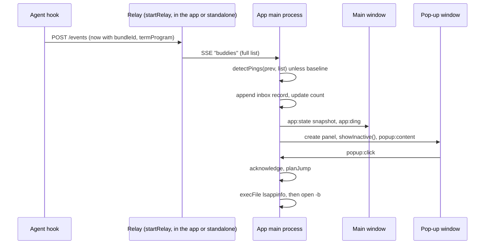

# Design: Messenger App

## Overview

The relay stays the single source of buddy state. The new Electron app is a client of its stream, plus a host that can start it. Everything the app decides (pings, acknowledgements, the menu bar count, hiding, jump plans, pop-up placement, status lines) is a pure function. Electron code only wires those functions to windows, the tray, files and two system commands.



## Architecture

```
src/core    config event text normalize history state buddies progress   (changed)
            launcher pings attention snapshot                              (new, pure)
src/hook    cli            reads two more environment variables
src/relay   start.ts       startRelay(), used by main.ts (CLI) and src/app
            static.ts      UI file lookup shared by server.ts and the app protocol
src/app     main process (Electron) and two preloads                       (new)
src/ui      main window screens, pop-up screen, sound                      (rewritten)
```

Import rules:
- `src/core` imports nothing outside `src/core`, and no Node built-ins (unchanged).
- `src/app` may import `src/core` and `src/relay`. Only the files marked "Electron" below import `electron`; every other `src/app` file is plain TypeScript, so Vitest can load it without Electron.
- `src/ui` imports `src/core` types and pure functions only. It never imports `src/app`; it talks to the main process through the preload bridge.
- Only `src/hook`, `src/relay` and `src/app` touch the file system or network. Only `src/ui` touches the DOM. The preloads do not touch the DOM.

## Changes to existing modules

### `src/core/launcher.ts` (new, Req 1)

```ts
export const BUNDLE_ID = /^[A-Za-z0-9][A-Za-z0-9-]*(\.[A-Za-z0-9][A-Za-z0-9-]*)+$/;   // and length <= 255
export const TERM_PROGRAM = /^[A-Za-z0-9][A-Za-z0-9._+-]{0,63}$/;
export function isBundleId(v: unknown): v is string;
export function isTermProgram(v: unknown): v is string;
export interface LauncherEnv { bundleId?: string | undefined; termProgram?: string | undefined }
export function launcherFields(env: LauncherEnv): { bundleId?: string; termProgram?: string }; // well-formed only
```

The bundle ID pattern rules out spaces, quotes, `;`, `=`, `$`, `/` and a leading `-` or `.`, so a value that passes can never be read as an option or as shell text, even before `execFile` adds its own protection.

### `src/core/event.ts`, `normalize.ts` (Req 1.1–1.4)
- `BuddyEvent` gains `bundleId?` and `termProgram?`. `validateEvent` keeps them for every agent when `isBundleId` / `isTermProgram` pass, and returns `null` when either is present and fails.
- `normalize(agent, raw, at, env)` takes `env: { projectDir?, bundleId?, termProgram? }` and adds `launcherFields(env)` before the final `validateEvent`. A malformed variable is dropped there, so the event is kept (Req 1.2).

### `src/hook/cli.ts` (Req 1.1, 1.5)
`normalize(..., { projectDir: env.CLAUDE_PROJECT_DIR, bundleId: env.__CFBundleIdentifier, termProgram: env.TERM_PROGRAM })`. No other change; no new file or network access.

### `src/core/history.ts`
`laterTask` becomes a special case of `latest(kept, item, pred)`, a running maximum under `compareStamped` for events that match `pred`. `hasLauncher(item)` is the predicate for Req 1.6.

### `src/core/state.ts` (Req 2.1, 2.2, 7.2)
- `displayState` returns `'ENDED'` for `ENDED`, whatever the time. `DisplayState` already includes `ENDED` through `CoreState`.
- `SessionRecord` gains `launcher?: Stamped`, the latest event that carries either launcher field.
- `foldSession` also records `textFromTask`: whether the event that gave the status text was a task event. It is part of the same fold, so it follows the window like the status text does.

### `src/core/buddies.ts` (Req 1.6–1.8, 2.3, 2.4)
- `URGENCY` is replaced by `RANK: Record<DisplayState, number>` = `WAITING_APPROVAL 0, WORKING 1, STALE 2, TURN_DONE 3, IDLE 4, OFFLINE 5, ENDED 5`.
- `compareSessions` sorts by rank, then latest last event, then key (unchanged otherwise). The buddy state is the first sorted session's state, so ties between `OFFLINE` and `ENDED` follow the existing tie rule. `mostUrgent` keeps its contract for P11: it returns one of its inputs and none has a lower rank.
- `applyEvent` keeps `launcher = latest(old?.launcher, item, hasLauncher)`.
- `SessionView` gains `bundleId?` and `termProgram?`, copied from `launcher`, and `task?: true` for a Kiro session whose `textFromTask` is set (Req 7.2).

### `src/core/text.ts` (Req 7)

```ts
export const PHRASES: Readonly<Record<DisplayState, string>>;   // table in Req 7.2
export const SPEC_TASK_PHRASE = '♪ studying hard';
export const STATUS_TEXT_LIMIT = 40;
export interface StatusParts { phrase: string; excerpt?: string }
export function statusParts(state: DisplayState, inSpecTask: boolean, statusText: string | undefined, hideText: boolean): StatusParts;
export function statusLine(parts: StatusParts): string;   // `phrase` or `phrase · excerpt`, for notifications
```

`statusParts` uses `SPEC_TASK_PHRASE` only for `WORKING` with `inSpecTask`; the excerpt is `truncate(statusText, 40)` unless hide-text is on or there is no text.

### `src/relay/start.ts` (new) and `main.ts` (Req 3)

```ts
export interface RelayOptions { port: number; uiDir: string; home?: string; onMessage?: (text: string) => void }
export interface RelayHandle { port: number; restored: number; stop(): Promise<void> }
export class PortInUseError extends Error { readonly code = 'PORT_IN_USE' }
export async function startRelay(opts: RelayOptions): Promise<RelayHandle>;
```

`startRelay` holds today's `main.ts` body: `ensureHome(home)`, token, store, stream, restore, progress reads, server. It awaits `listen` and maps `EADDRINUSE` to `PortInUseError`, after closing the stream and clearing the tick, so nothing keeps running (Req 3.3). Only then does it start the 30-second tick. `stop()` clears the tick, closes the stream, server and connections, and awaits `store.flush()`. It never calls `process.exit`, adds no signal handlers and writes nothing to stdout or stderr; `log write failed: <code>` goes to `onMessage` (Req 3.4).

`home.ts` functions take an optional base folder, defaulting to `~/.agentbuddy`, so tests can run `startRelay` in-process with a temp folder.

`main.ts` (the `agentbuddy` command) becomes about 30 lines: `parsePort`, `uiDir` from `import.meta.url`, `startRelay({ onMessage: console.error })`, the same `AgentBuddy relay: … (restored N events …)` line, `port <port> is in use (set AGENTBUDDY_PORT)` and exit 1 on `PortInUseError`, `relay error: <code>` and exit 1 on any other error, and SIGINT/SIGTERM calling `stop()` then exit 0 (Req 3.5). The existing relay tests, which spawn `dist/relay.js`, cover this unchanged.

### `src/relay/static.ts` (new)
`resolveUiFile(root, urlPath): { file: string; type: string } | null` moves out of `server.ts`: decode, reject `\0`, resolve inside `root`, look up the content type. The relay server and the app's `app://` protocol both use it, so both have the same path rules. The content types gain `.ttf` (`font/ttf`) and `.txt` (`text/plain; charset=utf-8`) for the bundled fonts and their licenses.

## New core modules

### `src/core/pings.ts` (Req 8.1–8.3)

```ts
export type AttentionState = 'WAITING_APPROVAL' | 'TURN_DONE';
export interface Ping { session: string; buddy: string; buddyName: string; state: AttentionState; title?: string; statusText?: string; startedAt: string }
export function detectPings(prev: readonly BuddyView[] | null, next: readonly BuddyView[]): Ping[];
```

`prev === null` returns `[]`. Otherwise it builds a map from session key to displayed state over `prev`, and returns one ping for each session in `next` whose state is an attention state and differs from its `prev` state (or has none). Pings come out in list order, which is stable for a given list.

### `src/core/attention.ts` (Req 10, 11.1, 13)

```ts
export type InboxRecord =
  | { t: 'ping'; at: string; session: string; buddyName: string; title?: string; startedAt: string; state: AttentionState }
  | { t: 'ack'; at: string; session: string };
export interface InboxEntry { at: string; session: string; buddyName: string; title?: string; startedAt: string; state: AttentionState; acked: boolean }

export function validateInboxRecord(value: unknown): InboxRecord | null;   // never throws
export function foldInbox(records: readonly InboxRecord[]): InboxEntry[];   // file order
export function ackRecords(entries: readonly InboxEntry[], sessions: Iterable<string>, at: string): InboxRecord[];
export function unackedSessions(entries: readonly InboxEntry[]): Set<string>; // latest entry unacknowledged
export function menuCount(views: readonly BuddyView[], entries: readonly InboxEntry[]): { waiting: number; unreadTurns: number; total: number };

export interface HiddenMark { lastAtMs: number; hiddenAtMs: number }
export type HiddenMap = ReadonlyMap<string, HiddenMark>;
export function hide(map: HiddenMap, session: SessionView, nowMs: number): HiddenMap;
export function refreshHidden(map: HiddenMap, views: readonly BuddyView[], nowMs: number): HiddenMap;
export function isHidden(map: HiddenMap, session: SessionView): boolean;
```

- `foldInbox`: an `ack` record acknowledges every earlier `ping` entry of its session. Records are appended, never rewritten, so the file is its own history (Req 10.8, 11.2).
- `ackRecords` returns one `ack` per given session that still has an unacknowledged entry, so repeated clicks add nothing.
- `menuCount`: for each session in the list, 1 if its displayed state is `WAITING_APPROVAL` (Req 10.6); 1 if it is `TURN_DONE` and its latest entry is a `TURN_DONE` entry that is unacknowledged (Req 10.5); else 0. Hidden sessions are not left out (Req 13.4).
- `refreshHidden` drops a mark when the session's last event is later than `lastAtMs` (a new event, Req 13.1), and when `hiddenAtMs` is more than 24 hours before `now` (Req 13.5). A mark whose session is not in the list is kept until its 24 hours pass, so a relay restart does not unhide everything.

### `src/core/snapshot.ts` (types only)
The contract between the main process and the windows, like `BuddyView` is between relay and UI.

```ts
export type RelayMode = 'connecting' | 'own' | 'attached' | 'browser';   // 'browser': the relay's page, no app
export type Connection = 'ok' | 'disconnected' | 'foreign' | 'error';
export interface PublicSettings { hideText: boolean; sound: boolean; popups: boolean; macNotifications: boolean; alwaysOnTop: boolean; closedGroups: string[] }
export interface AppSnapshot {
  mode: RelayMode; port: number; connection: Connection; errorCode?: string;   // errno code for 'error'
  buddies: BuddyView[]; hidden: string[]; unacked: string[];
  inbox: InboxEntry[]; settings: PublicSettings;
  count: { waiting: number; unreadTurns: number; total: number };   // alert strip and menu bar
}
export type ClickTarget = { kind: 'buddy' | 'session' | 'inbox'; key: string };
export type PopupContent =
  | { kind: 'ping'; state: AttentionState; agent: string; folder: string; time: string; phrase: string; detail?: string }
  | { kind: 'notice'; text: string };
```

## `src/app`: the main process

| File | Electron | Role |
|---|---|---|
| `main.ts` | yes | entry: switches, single instance, Dock, protocol, windows, tray, wiring |
| `config.ts` | no | app constants (below) |
| `controller.ts` | no | app state and decisions; effects through ports |
| `relay-link.ts` | no | start own relay or attach; SSE client; retries |
| `sse.ts` | no | SSE text parser and `BuddyView[]` shape check |
| `jump.ts` | no | `planJump` (pure) and `runJump` (injected `execFile`) |
| `inbox-file.ts` | no | read today's inbox file, ordered appends |
| `settings.ts` | no | `parseSettings` (pure), load, atomic save |
| `ipc.ts` | no | channel names and argument validators |
| `window-options.ts` | no (types only) | `mainWindowOptions`, `popupWindowOptions` |
| `popup-layout.ts` | no | `placePopups` |
| `icon.ts` | no | menu bar pixel art as an RGBA buffer |
| `security.ts` | yes | navigation, new windows, permissions, request blocking, IPC sender check |
| `protocol.ts` | yes | `app://ui/…` serving `dist/ui` |
| `windows.ts` | yes | main window: create, show, hide on close, always on top |
| `popups.ts` | yes | pop-up windows: create, stack, auto-close, click |
| `tray.ts` | yes | menu bar icon, title, menu |
| `notify.ts` | yes | optional macOS notifications |
| `preload-main.ts`, `preload-popup.ts` | yes (sandboxed preload) | the two bridges |

`config.ts`: `RETRY_MS = 3000`, `FIRST_LIST_MS = 5000`, `STALL_MS = 60_000` (no data, not even the 25-second heartbeat), `JUMP_TIMEOUT_MS = 3000`, `POPUP_MS = 6000`, `POPUP = { width: 300, height: 136, gap: 10, margin: 12 }` (the card of the mockup: 26 px title, about 70 px body, 36 px buttons, 2 px border), `MAIN = { width: 320, height: 620, minHeight: 420, margin: 12 }` (`minWidth` and `maxWidth` are both 320), `TICK_MS = 30_000`.

### `main.ts` (Req 4.2, 5, 15)
Before `ready`: `app.enableSandbox()`; `app.commandLine.appendSwitch('autoplay-policy', 'no-user-gesture-required')` (Req 8.7); `protocol.registerSchemesAsPrivileged([{ scheme: 'app', privileges: { standard: true, secure: true } }])`; `app.requestSingleInstanceLock()` or quit; `second-instance` shows the main window (Req 4.2).

`app.on('window-all-closed', () => {})`, so the app keeps running in the menu bar when its last window closes; without a listener Electron quits (seen in O4 run A when its only window closed). On `ready`: `app.dock?.hide()` (Req 5.7); `installSecurity()`; `registerAppProtocol(uiDir)`; load settings and today's inbox; create the controller; create the main window, tray and pop-up manager; start `relay-link`; a 30-second `setInterval` calls `controller.onTick()`. `before-quit` sets a flag so the main window's `close` handler stops hiding it, closes pop-ups, and awaits `link.stop()` (Req 4.7).

`uiDir` is `join(__dirname, '..', 'ui')`, the same `dist/ui` the relay serves.

### `controller.ts` (Req 5.3, 8, 10, 12.1–12.2, 13, 14)

```ts
export interface Ports {
  now(): number; dayKey(ms: number): string;
  appendInbox(r: InboxRecord): void; saveSettings(s: Settings): void;
  pushState(s: AppSnapshot): void; setCount(total: number): void; ding(): void;
  windowAction(action: 'minimize' | 'close'): void;
  showPopup(session: string | null, content: PopupContent): void; closePopups(sessions: readonly string[]): void;
  notify(session: string, title: string, body: string): void;
  jump(plan: JumpPlan): void; notice(text: string): void;
  applyAlwaysOnTop(on: boolean): void; isDirectory(path: string): boolean;
}
export function createController(init: { settings: Settings; records: InboxRecord[]; port: number }, ports: Ports): {
  onList(list: BuddyView[], baseline: boolean): void;
  onLink(mode: RelayMode, connection: Connection): void;
  onClick(target: ClickTarget | { kind: 'notification'; key: string }): void;
  onPopup(session: string, action: 'go' | 'close' | 'later'): void;   // Go there: as a session click; ×: acknowledge, no jump; Later: nothing
  onAckAll(): void; onHide(session: string): void; onWindow(action: 'minimize' | 'close'): void;
  onSetting(key: SettingKey, value: boolean): void; onGroup(folder: string, open: boolean): void;
  onTick(): void;
};
```

- `onList`: `pings = baseline ? [] : detectPings(prev, list)`; `prev = list`; `hidden = refreshHidden(...)`. For each ping: append a `ping` record (always, Req 8.4); if pop-ups are on, `showPopup`; if macOS notifications are on, `notify`. One `ding()` if there was any ping and sound is on (Req 8.5). Then count and state.
- `onClick`: `buddy` acknowledges every session of that buddy and jumps to its first session (the one whose status line the row shows, Req 12.1, 10.3); every other kind acknowledges that one session and jumps to it. `onPopup` with `go` works like a session click, with `close` (×) acknowledges and jumps nowhere, and with `later` does nothing (Req 9.5). Hide-text strips status text and titles from the snapshot sent to the main window, as well as from pop-ups and notifications; the inbox file keeps titles, like the daily log keeps text. (Updated in task 7.6: one `onPopup` instead of `onPopupClose`.) Acknowledging appends `ackRecords` and calls `closePopups` (Req 9.8). The click acknowledges before the jump is planned, so a failed jump still acknowledges (Req 10.7).
- `onAckAll`: acknowledges every session with an unacknowledged entry of today, closes their pop-ups, and jumps nowhere (Req 10.2).
- `onHide`: `hide(...)`, acknowledge, save settings.
- `onWindow`: passes the title bar's minimize or close-to-menu-bar to `windowAction`. The pin button is the `alwaysOnTop` setting, so it goes through `onSetting`.
- `onTick`: drops records of an earlier day from memory when `dayKey(now)` changes (the inbox shows today only), runs `refreshHidden`, and pushes state if anything changed.
- Pop-up content: `state`, `agent` (`Codex`), `folder` (`agentbuddy`), `time` (`HH:MM` of the ping), `phrase`, and `detail`: the excerpt for `TURN_DONE` when there is one, else `session · <title>` (or `session · started HH:MM:SS`); no `detail` while hide-text is on (Req 9.7).
- Every handler ends with `setCount(menuCount(...).total)` and `pushState(snapshot())`. Text never reaches a port when hide-text is on: pop-up and notification content leave out the title and the excerpt (Req 7.4).

The controller has no timers and no I/O of its own, so the tests drive it with fake ports and a fake clock.

### `relay-link.ts` and `sse.ts` (Req 4.3–4.7, 4.9)

```ts
export function createRelayLink(opts: {
  port: number; uiDir: string; start: typeof startRelay;
  connect: (port: number) => SseConnection;   // node:http GET 127.0.0.1:<port>/stream
  onList(list: BuddyView[], baseline: boolean): void;
  onLink(mode: RelayMode, connection: Connection): void;
}): { stop(): Promise<void> };
```

One `attempt()`:
1. Unless it already owns a relay, call `start`. Success → mode `own`. `PortInUseError` → mode `attached`. Any other error → connection `error` with its errno code (shown as `relay error: <code>`) and a retry.
2. Connect to `/stream`, with no token header (Req 4.9). Status 200 and `text/event-stream` are required. The first `buddies` message whose data `parseViews` accepts must arrive within `FIRST_LIST_MS`; otherwise connection `foreign` (Req 4.5). The first accepted list is passed with `baseline: true`, later ones with `false`.
3. On close, error, or `STALL_MS` without bytes: connection `disconnected`, then `attempt()` again after `RETRY_MS` (Req 4.6). Because step 1 tries `start` first, a retry that finds the port free becomes `own` (A11).

`sse.ts`: `createSseParser(onEvent)` accepts chunks, splits on blank lines, joins `data:` lines, ignores comments (`: ping`), and caps one message at 4 MB. `parseViews(text)` returns `BuddyView[]` or `null`: an array of objects whose `key`, `name`, `cwd` are strings, `agent` is a known agent, and `sessions` an array of objects with a string `key` and a known `state`. Malformed buddies or sessions are dropped, not passed on. A relay from the core-pipeline build is accepted; its sessions simply have no launcher.

### `jump.ts` (Req 12)

```ts
export type JumpPlan =
  | { kind: 'notice'; text: string }
  | { kind: 'run'; bundleId: string; folder?: string };
export function planJump(views: readonly BuddyView[], session: string, isDirectory: (p: string) => boolean): JumpPlan;
export function runJump(plan: JumpPlan, exec: Exec, notice: (t: string) => void): Promise<void>;
type Exec = (file: string, args: readonly string[], opts: { timeout: number }) => Promise<{ stdout: string }>;
```

`planJump`:
1. Session not in the list → notice `this session is gone`.
2. No `bundleId`, or `isBundleId` fails → notice `can't tell which app this session is in` (Req 12.3, 12.9).
3. `folder` only when `bundleId === 'dev.kiro.desktop'`, the session's state is neither `OFFLINE` nor `ENDED`, and the buddy's `cwd` (the session folder from the relay's list) is absolute and `isDirectory` says yes at that moment (Req 12.7). The folder comes from the main process's copy of the list, never from the window.

`runJump` (Req 12.4–12.6, 12.11), with `exec` = promisified `execFile` (no shell):
1. `exec('/usr/bin/lsappinfo', ['find', 'bundleid=' + id], { timeout: 3000 })`. Empty stdout → notice `<id> is not running`, stop (A10).
2. `exec('/usr/bin/open', folder ? ['-b', id, folder] : ['-b', id], { timeout: 3000 })`.
3. Any rejection (exit 1 for an unknown ID, timeout) → notice `couldn't bring <id> forward`.

Fixed absolute program paths mean `PATH` cannot redirect the commands. Every argument is one array item; the only one that starts with `-` is the literal `-b`.

### `inbox-file.ts` and `settings.ts` (Req 11.2–11.5, 14)
- Inbox: `inboxFileName(d)` = `inbox-YYYY-MM-DD.jsonl` (local date). `readInbox(dir, now)` reads today's file, keeps lines that pass `validateInboxRecord`, and returns `[]` on any read error. `createInboxWriter(dir, onError)` chains appends like the relay's daily log, with `{ flag: 'a', mode: 0o600 }`. A failed append calls `onError(code)` and the record stays in the controller's memory (Req 11.5).
- Settings: `parseSettings(value): Settings` never throws and keeps only known keys of the right type, else defaults (`hideText` false, `sound` true, `popups` true, `macNotifications` false, `alwaysOnTop` true), plus `closedGroups` (at most 200 strings of at most 1024 characters) and `hidden` (at most 500 marks). `saveSettings` writes `app-settings.json.tmp` with mode 600 and renames it over `app-settings.json`, so a crash never leaves half a file. `main.ts` coalesces saves within 500 ms.

### `ipc.ts` and the preloads (Req 15.2, 15.3)

| Channel | Direction | Payload | Check |
|---|---|---|---|
| `app:state` | main → main window | `AppSnapshot` | |
| `app:ding` | main → main window | none | |
| `app:screen` | main → main window | `'list' \| 'inbox'` | |
| `app:notice` | main → main window | `{ text }` | |
| `ui:ready` | main window → main | none | |
| `ui:click` | main window → main | `ClickTarget` | `kind` in the three; `key` string of 1–1024 characters |
| `ui:hide` | main window → main | `{ session }` | string of 1–1024 characters |
| `ui:setting` | main window → main | `{ key, value }` | `key` in the five setting names; `value` boolean |
| `ui:group` | main window → main | `{ folder, open }` | string of 1–1024 characters; boolean |
| `ui:ackAll` | main window → main | none | |
| `ui:window` | main window → main | `{ action }` | `minimize` or `close` |
| `popup:content` | main → pop-up | `PopupContent` | |
| `popup:click` | pop-up → main | `{ action }` | `go`, `close` or `later`; the sender must be a live pop-up; main maps it to its session |

`preload-main.ts` exposes `window.agentbuddy = { onState, onDing, onScreen, onNotice, ready, click, ackAll, hide, setSetting, setGroupOpen, windowAction }`. Each `on…` wraps `ipcRenderer.on` and passes only the payload, never the event object. `preload-popup.ts` exposes `window.agentbuddyPopup = { onContent, go, close, later }`. The renderer reads the inbox and settings from `AppSnapshot`, so no read call exists.

`security.ts` registers each `ipcMain.on` through `trusted(channel, kind, handler)`: the sender's frame URL must start with `app://ui/`, `BrowserWindow.fromWebContents(sender)` must be the main window (`ui:*`) or a live pop-up (`popup:*`), and the payload must pass its validator. Anything else is dropped without a reply.

### `security.ts`, `protocol.ts`, `window-options.ts` (Req 15, 16.3)
- `window-options.ts` returns plain objects, tested without Electron. Shared `webPreferences`: `contextIsolation: true`, `nodeIntegration: false`, `sandbox: true`, `webSecurity: true`, `spellcheck: false`, `preload`. Main window: `frame: false` (the title bar is drawn by the page, Req 5.9), `width: 320`, `minWidth: 320`, `maxWidth: 320`, `height: 620`, `minHeight: 420`, `resizable: true`, `maximizable: false`, `fullscreenable: false`, `backgroundColor: '#F4F8FD'`, and `backgroundThrottling: false`, so the ding and timers run while hidden (Req 8.7). It is not transparent, because Electron documents that transparent windows are not resizable; macOS gives the frameless window its own rounded corners (see Visual design). Pop-up: `type: 'panel'`, `focusable: false`, `acceptFirstMouse: true`, `frame: false`, `transparent: true`, `resizable: false`, `movable: false`, `minimizable: false`, `maximizable: false`, `fullscreenable: false`, `skipTaskbar: true`, `hasShadow: false`, `alwaysOnTop: true`, `show: false`.
- `installSecurity()`: on every `web-contents-created`: `will-navigate` and `will-redirect` → `preventDefault`; `setWindowOpenHandler(() => ({ action: 'deny' }))`; `will-attach-webview` → `preventDefault`. Default session: `setPermissionRequestHandler` → deny; `setPermissionCheckHandler` → false; `webRequest.onBeforeRequest({ urls: ['<all_urls>'] }, …)` cancels every request whose URL does not start with `app://ui/` (Req 15.4). The filter must let our own files through by that prefix: in O4 run A (2026-11-12, Electron 45.3.1), `<all_urls>` also matched the custom `app://` scheme and cancelled the page itself (`ERR_BLOCKED_BY_CLIENT`). The app never calls `crashReporter.start` or `autoUpdater`, and `spellcheck: false` avoids dictionary downloads (Req 16.3).
- `protocol.ts`: `protocol.handle('app', …)` serves only host `ui`, through `resolveUiFile(uiDir, path)`, with `Content-Security-Policy: default-src 'self'` and `X-Content-Type-Options: nosniff` (Req 15.5). Other hosts or paths → 404. The CSP is a header, not a `<meta>` tag, so `npm run dev` with Vite's injected styles keeps working.

### `windows.ts` (Req 5.1, 5.2, 5.5)
The main window loads `app://ui/index.html`, `show: false`, then `ready-to-show` → `show()`. It is placed at the top-right of `screen.getPrimaryDisplay().workArea` with a 12-point margin. While always-on-top is on: `setAlwaysOnTop(true, 'floating')`. `close` → `preventDefault(); hide()` unless quitting. The title bar's close button sends `ui:window close`, which hides the same way; its minimize button sends `ui:window minimize` → `minimize()` (Req 5.12; O4 checks where the window goes with no Dock icon, and the tray's "Show buddy list" also restores a minimized window). "Show buddy list" in the tray: `restore()` if minimized, `show()`, then `app.focus({ steal: true })`, since the user asked for it. `render-process-gone` → reload.

### `popups.ts` and `popup-layout.ts` (Req 9)

```ts
export function placePopups(count: number, area: Rect, size: Size, gap: number, margin: number): Point[]; // index 0 = oldest, at the bottom
export function popupCapacity(area: Rect, size: Size, gap: number, margin: number): number;
```

The manager keeps open pop-ups oldest first, each with its session (or `null` for a notice) and a close timer of `POPUP_MS`. `show`: if the stack is full, close the oldest (Req 9.6); create the panel at its slot; load `app://ui/popup.html`; on `did-finish-load`, send `popup:content`, then `showInactive()` and `setVisibleOnAllWorkspaces(true, { visibleOnFullScreen: true })` (Req 9.2, 9.3). `showInactive` neither activates the app nor makes the panel key, and the `panel` type is non-activating (Electron docs, `type` option). When a pop-up closes, the rest are moved down with `setBounds`, which also takes no focus, so the newest is always on top. `popup:click` closes that pop-up and passes its action to `controller.onPopup(session, action)`: `later` leaves the entry unacknowledged, `close` (×) acknowledges, `go` (`Go there →` or the rest of the card) acknowledges and jumps (Req 9.5). The rising motion is a CSS animation inside the window, so the window itself never moves while it appears.

Notices (Req 12.9) go to the main window while it is visible (`app:notice`, shown in the footer for 4 s with an `alert` dot, then the relay status comes back), and to a notice pop-up while it is hidden.

### `tray.ts` and `icon.ts` (Req 5.3, 5.4, 5.8)
`icon.ts` builds the bubble of design.md on a 16×16 grid: a 14×10 block at (1, 2), a 3×3 tail at (3, 12), and two 2×2 eyes at (5, 6) and (9, 6) left transparent. The 32×32 version doubles every pixel. A pure function turns the grid into an RGBA buffer (black where filled, alpha 0 elsewhere). `tray.ts` makes it a template image with `nativeImage.createFromBitmap` plus `addRepresentation` for the 2× size, so macOS tints it for light and dark menu bars and no image file ships. `setCount(n)` → `tray.setTitle(n > 0 ? String(n) : '')`. Menu: `Show buddy list`, `Show inbox`, separator, `Quit AgentBuddy` (`app.quit()`). An application menu with the `quit` role keeps Cmd+Q working while a window is focused (Req 5.6).

### `notify.ts` (Req 8.8, 8.9)
When macOS notifications are on and `Notification.isSupported()`: `new Notification({ title, body, silent: true })`, `click` → controller `{ kind: 'notification', session }`. On `failed` (O4 run A: `UNErrorDomain` error 1, notifications not allowed, when Electron runs from source), the app shows the notice `macOS did not allow the notification (System Settings › Notifications)` once per run and keeps the pop-ups and the ding going. Open notifications are kept in a `Set` until `close` or `click`, so they are not garbage-collected before their click arrives.

## `src/ui`

| File | Role |
|---|---|
| `main.ts` | picks the source: `window.agentbuddy` (app) or `EventSource('/stream')` (browser); screen switching; re-renders every 30 s so relative times move |
| `bridge.ts` | types of the two bridges; the browser source turns `BuddyView[]` into a snapshot with defaults and mode `browser` |
| `model/list.ts` | pure: groups, online counts, the offline group, buddy rows, session rows, the hidden-sessions line |
| `model/chrome.ts` | pure: alert strip, inbox badge, footer, connections card |
| `model/inbox.ts` | pure: inbox rows and the unread count |
| `icons.ts` | the seven state icons and the bubble, built as SVG with `createElementNS` |
| `chrome.ts` | title bar, alert strip, tabs, footer |
| `screens/list.ts`, `screens/inbox.ts`, `screens/settings.ts` | the three tabs |
| `screens/popup.ts` | the pop-up page |
| `sound.ts` | the ding |
| `styles/tokens.css`, `styles/fonts.css`, `styles/main.css`, `styles/popup.css` | look (Visual design) |
| `public/fonts/` | font files and their OFL licenses, copied to `dist/ui/fonts/` as they are |

`model/list.ts` (Req 6, 7):

```ts
export interface GroupVM { id: string; kind: 'folder' | 'offline'; label: string; path?: string;
  online: number; total: number; open: boolean; buddies: BuddyVM[] }
export interface BuddyVM { key: string; agent: AgentId; name: string; state: DisplayState; parts: StatusParts;
  count?: number; unread: boolean; progress?: { text: string; ratio?: number }; hover?: string;
  hide?: string;   // session key for the buddy-row ×, set when exactly one session is visible
  sessions: SessionVM[]; more?: { text: string; shown: boolean } }
export interface SessionVM { key: string; state: DisplayState; name: string; phrase: string; age: string;
  top: boolean; tree: '├' | '└'; unread: boolean }
export function buildGroups(s: AppSnapshot, showMore: ReadonlySet<string>, nowMs: number): GroupVM[];
```

- A buddy is online unless every session is `OFFLINE` or `ENDED`. Folder groups hold the online buddies of one `cwd`, with `online`/`total` counted over all buddies of that folder; a folder group with no online buddy is left out. The last group, `offline`, holds the rest, closed by default, with each buddy named by its display name (Req 6.1–6.3).
- `label` is the folder name, plus ` (parent)` when two folder groups share a folder name; `path` is the full folder for the hover text. Group `open` comes from `closedGroups`.
- Visible sessions: all but `IDLE`, `OFFLINE`, `ENDED` and hidden ones, unless the buddy is in `showMore`. `count` is set when two or more are visible. Session rows are built only when two or more are visible, or while `showMore` holds the buddy (Req 6.4, 6.5).
- `more.text` counts the left-out sessions by kind, in the order idle, offline, logged off, hidden, then `· show` (or `· hide` while shown): `2 logged off · show` (Req 6.6).
- `hide`: the key of the only visible session, when exactly one is visible (Req 6.4). With two or more, the session rows carry the ×.
- `parts`: `statusParts(state, session.task === true, statusText, hideText)` of the buddy's first session. A session row shows only its `phrase` (Req 6.5).
- `name` of a session: its title, or `started HH:MM:SS` when it has none or hide-text is on. `age`: `now` under one minute, `Nm` under an hour, else `Nh`. `top` marks the first session, which sets the buddy state. `tree` is `└` for the last row and `├` for the others.
- Kiro `progress`: `{ text: 'n/m', ratio: n/m }` when known, `{ text: '?/?' }` when `null`. Codex `hover`: `Codex reports finished turns only` (Req 6.8).
- `unread`: the session key is in `unacked`; a buddy is unread when any of its sessions is.
- In browser mode `unacked` and `hidden` are empty, and the screens draw no ×, no unread dots and no click handlers (Req 6.12).

`model/chrome.ts`: `alertText(count)` gives `1 needs your OK` / `2 need your OK` and `1 done, unread`, joined by ` · `, or nothing when the total is 0 (Req 5.10). `footer(s, tab)`: on Buddies a dot (`ok`, `muted`, `alert`) and `relay connected · local only`, `connecting to relay…`, `relay disconnected`, `port <port> is used by another program` or `relay error: <code>`, plus `on top ✓` while pinned; on Inbox `kept on this computer only` and `click a message to go there`; on Settings nothing (Req 5.11, 6.10). The alert strip and the pin button belong to the Buddies tab only (Req 5.9, 5.10). `connections(s)` gives `Relay · 127.0.0.1:<port> · in this app` or `· attached` with the connection's dot, and per agent `<Agent> · hooks on` (green) when it has a session in the list, else `<Agent> · no events in 24 h` (ring); Codex shows `Codex · finished turns only` with the idle dot instead of `hooks on` (Req 14.1).

`model/inbox.ts`: rows newest first with the state, `agent` and `folder` (from `buddyName`), `line` = `need your OK · <name>` or `turn done · <name>` (`· started HH:MM:SS` without a title or with hide-text on), `HH:MM` and `unread`; `header` = `Today · n unread` (Req 11.3).

`screens/*` build with `createElement` and `textContent` only (Req 6.9). Each buddy and session row holds a main `<button>`, so a click and Enter both work; a session row's ×, and the buddy row's × when `hide` is set, are separate `<button>`s beside the main one, never inside it. A buddy row's button calls `click('buddy', key)`; a session row's `click('session', key)`; each × calls `hide(sessionKey)`; the hidden-sessions line's `show` is a `<button>` that toggles `showMore` locally; group headers call `setGroupOpen`; an inbox row calls `click('inbox', session)`; `Mark all read` calls `ackAll()`.

`sound.ts` (Req 8.6, 8.7): one `AudioContext`, created at load. `ding()` resumes it if suspended, then plays two triangle-wave notes: 1047 Hz for 90 ms, then 1568 Hz for 360 ms, each with a short attack and an exponential decay, peak gain 0.25. The builder tunes the notes by ear in the task.

`screens/popup.ts` fills the card from `popup:content` with `textContent`. × calls `close()`, `Later` calls `later()`, and `Go there →` and a click anywhere else on the card call `go()` (Req 9.5).

`index.html` holds the window frame, title bar, alert strip, tabs, the three screens and the footer (Visual design). A new `popup.html` holds the pop-up card. `vite.config.ts` lists both pages as build inputs and sets `publicDir: 'src/ui/public'`.

## Agents and privacy (Req 16)

- Nothing in `src/app` writes outside `~/.agentbuddy/`, and nothing reads or writes agent settings or hooks. The only programs it runs are `/usr/bin/lsappinfo` and `/usr/bin/open`, and only to bring an app forward.
- The hook command's timing is unchanged; it does not know whether the app runs. With the app quit and no relay, hooks log `post_ECONNREFUSED` and exit 0 as before.
- The app's only connection is the main process's `node:http` request to `127.0.0.1:<port>/stream`. Windows load only `app://ui/…`, and every other request from them is cancelled.

## Data models

- **BuddyEvent**: two new optional fields (events.md). Daily log lines carry them as sent.
- **SessionView**: new optional `bundleId`, `termProgram` and `task`; `state` may be `ENDED`.
- **Inbox file** `~/.agentbuddy/inbox-YYYY-MM-DD.jsonl` (mode 600): one `InboxRecord` per line, appended. Example lines:
  ```json
  {"t":"ping","at":"2026-11-12T07:01:02.000Z","session":"[\"kiro\",\"sess_0bcd…\"]","buddyName":"Kiro @ demo","title":"Change the line in hello.txt","startedAt":"2026-11-12T06:58:40.000Z","state":"TURN_DONE"}
  {"t":"ack","at":"2026-11-12T07:01:30.000Z","session":"[\"kiro\",\"sess_0bcd…\"]"}
  ```
- **Settings file** `~/.agentbuddy/app-settings.json` (mode 600):
  ```json
  {"v":1,"hideText":false,"sound":true,"popups":true,"macNotifications":false,"alwaysOnTop":true,
   "closedGroups":["/Users/dev/demo"],"hidden":{"[\"claude\",\"e697…\"]":{"lastAt":"…","hiddenAt":"…"}}}
  ```

## Visual design

Sources: `.kiro/steering/design.md` (it decides the look) and `docs/mockups/Main.dc.html`, `Inbox.dc.html`, `Settings.dc.html`, `Popup.dc.html`, `Icons.dc.html` (exact sizes and copy). Behavior follows the requirements, including the revisions table there.

### Tokens (`styles/tokens.css`)
CSS custom properties, the only place a hex value appears. design.md's palette table, plus the colors its own sections and the mockups use (design.md says "no other colors", but uses these; no color beyond this list is added):

| Token | Hex | Use |
|---|---|---|
| `--frame` | `#1D5FB8` | window border, title gradient bottom, done `Go there →` |
| `--title-top` | `#4A9BEA` | title gradient top, progress stripe |
| `--button` | `#2F78D0` | title bar buttons, pop-up ×, progress stripe |
| `--button-line` | `#BFD9F5` | title bar button border |
| `--deep` | `#123F7D` | title text outline, done `Go there →` border |
| `--body` | `#F4F8FD` | window background, active tab, `Later` (done) |
| `--row` | `#FFFFFF` | rows, cards |
| `--on-fill` | `#FFFFFF` | text and glyphs on filled colors (the same white as `--row`, under its own name) |
| `--group` / `--group-text` | `#E8F0FA` / `#1B3A66` | group headers |
| `--band` / `--band-line` / `--band-text` | `#DDE9F7` / `#A9C6E8` / `#33465F` | tabs, footer |
| `--line` / `--line-soft` | `#C9DBF0` / `#EEF3F9` | dividers |
| `--tile` / `--tile-line` | `#EAF2FC` / `#8FB8E6` | progress track and border |
| `--text` / `--text-2` | `#1B2433` / `#4E5B6E` | text |
| `--alert` / `--alert-strong` / `--alert-top` | `#D9541E` / `#C2471A` / `#F59A4E` | needs-OK icon and dot, close button; badge and needs-OK buttons; needs-OK title gradient top |
| `--alert-text` / `--alert-later` / `--alert-shadow` | `#8A3C00` / `#6B3000` / `#B8461A` | needs-OK text and title outline; `Later` text; needs-OK card shadow |
| `--alert-strip` / `--alert-strip-line` / `--alert-tint` | `#FFF3E6` / `#F3C99B` / `#FFF8F1` | alert strip; needs-OK row and card tints |
| `--close-line` | `#FFD2B8` | close button border |
| `--ok` / `--ok-text` | `#2E9E4F` / `#1E6B35` | working icon, connected dot; working text |
| `--done` / `--done-text` / `--done-tint` | `#2F6FDE` / `#1D4FA8` / `#F7FAFE` | turn-done icon; text; unread tint |
| `--idle` | `#B8860B` | idle icon, Codex dot |
| `--stale` / `--ring` | `#6E7A8C` / `#8C99AA` | stale icon; offline and ended rings, tree marks |

### Fonts (`styles/fonts.css`, `public/fonts/`)
- Files from the Google Fonts repository (`ofl/nanumgothic`, `ofl/silkscreen`; both list `license: "OFL"` in their `METADATA.pb`): `NanumGothic-Regular.ttf` (400), `NanumGothic-Bold.ttf` (700), `NanumGothic-ExtraBold.ttf` (800), `Silkscreen-Regular.ttf` (400), with `OFL-NanumGothic.txt` and `OFL-Silkscreen.txt`. They are copied once while building this spec and committed; nothing fetches them at run time (Req 16.5). The mockups' Google Fonts `<link>` is for the mockups only.
- `@font-face` rules point at `/fonts/…` with `font-display: block`, so text never flashes in a fallback font.
- Stacks: text `'Nanum Gothic', sans-serif`, 12 px; titles `Silkscreen, 'Nanum Gothic', monospace`, 11–13 px, so Korean in a title falls back to Nanum Gothic. Weights: 800 for names, 700 for phrases and emphasis.
- Glyph coverage (read from the files' `cmap` tables in task 9): Silkscreen has none of `♪ ★ → ▲ ▼ ▶ ├ └`, so `Ding! ♪ …` titles take the `♪` from Nanum Gothic; Nanum Gothic has all of these but not `✓`, so `on top ✓` takes it from the system font.

### Main window (`index.html`, `main.css`)

```html
<div class="window">
  <header class="titlebar">                  <!-- -webkit-app-region: drag; buttons: no-drag -->
    <svg class="bubble" aria-hidden="true"></svg><span class="app-title">AgentBuddy</span>
    <button class="tb-btn tb-pin" aria-label="Pin on top" aria-pressed="true">▲</button>
    <button class="tb-btn tb-min" aria-label="Minimize">_</button>
    <button class="tb-btn tb-close" aria-label="Close to menu bar">×</button>
  </header>
  <div class="alert-strip" role="status" hidden><svg class="icon"></svg><span></span></div>
  <nav class="tabs" role="tablist">
    <button class="tab" role="tab" aria-selected="true">Buddies</button>
    <button class="tab" role="tab">Inbox <span class="badge">2</span></button>
    <button class="tab" role="tab">Settings</button>
  </nav>
  <main class="screen screen-list" role="tabpanel"></main>
  <section class="screen screen-inbox" role="tabpanel" hidden></section>
  <section class="screen screen-settings" role="tabpanel" hidden></section>
  <footer class="statusbar"><span class="dot" data-dot="ok"></span><span class="status-text"></span><span class="ontop">on top ✓</span></footer>
</div>
```

Buddy list content:

```html
<button class="group-head" aria-expanded="true" title="/Users/dev/agentbuddy">
  <span class="caret">▼</span> <span class="group-name">agentbuddy</span> <span class="group-count">(3/3 online)</span>
</button>
<div class="buddy" data-state="WAITING_APPROVAL">
  <button class="buddy-main" title="…">
    <svg class="icon" aria-hidden="true"></svg><span class="sr-only">waiting for approval</span>
    <span class="buddy-name">Claude Code</span> <span class="buddy-count">[2]</span>
    <span class="buddy-status">(<span class="phrase">need your OK T_T</span><span class="excerpt"> · delete hello.txt?</span>)</span>
    <span class="progress-text">16/19</span> <span class="unread-dot" aria-label="unread"></span>
  </button>
  <button class="buddy-hide" aria-label="Hide this session">×</button>   <!-- only with exactly one visible session -->
  <div class="progress" aria-hidden="true"><div class="progress-fill"></div></div>
  <div class="session" data-state="WAITING_APPROVAL" data-top>
    <span class="tree" aria-hidden="true">├</span>
    <button class="session-main"><svg class="icon"></svg><span class="sr-only">…</span>
      <span class="session-name">fix login</span> <span class="session-phrase">(need your OK T_T)</span> <span class="session-age">2m</span></button>
    <button class="session-hide" aria-label="Hide this session">×</button>
  </div>
  <div class="more"><span class="more-text">2 logged off · </span><button class="more-toggle">show</button></div>
</div>
```

Measurements, all from `Main.dc.html`:
- `.window`: 3 px `--frame` border, `--body` background, flex column filling the window. Title bar: padding 6/8 px, gap 8, gradient `--title-top` → `--frame`, white text; `.app-title` Silkscreen 13 px. `.tb-btn`: 22×20, radius 3, 1 px `--button-line` border, `--button` fill, 11 px white glyph; `.tb-close` `--alert` fill and `--close-line` border. `.tb-pin[aria-pressed="false"]` at 60 % opacity.
- `.alert-strip`: padding 7/10, `--alert-strip` background, 1 px `--alert-strip-line` bottom border, `--alert-text` bold, 14 px needs-OK icon.
- Per tab (mockups): Buddies has the pin button, the alert strip and the relay footer; Inbox has the inbox footer; Settings has neither the pin button nor a footer.
- `.tabs`: `--band`, padding 6/8/0, gap 4, 1 px `--band-line` bottom border. `.tab`: padding 6/12, radius 6/6/0/0, `--band-text`. `[aria-selected="true"]`: `--body` background, `--band-line` border without the bottom one, `--text`, weight 800. `.badge`: min-width 16, padding 0/4, radius 8, 10 px bold white on `--alert-strong`.
- `.group-head`: full width, padding 6/10, `--group` background, `--group-text`, weight 800, 1 px `--line` bottom border; `.group-count` weight 400 `--text-2`. The offline group header uses `--text-2` for its name.
- `.buddy-main`: one line, padding 6/10, gap 6, 1 px `--line-soft` top border between buddies; 14 px icon; `.buddy-name` weight 800; `.buddy-count` `--text-2`; `.buddy-status` takes the rest with `text-overflow: ellipsis`, `--text-2`; `.phrase` bold in the state text color (`--alert-text`, `--ok-text`, `--done-text`; `--text-2` and weight 400 for the others); `.progress-text` weight 700 `--band-text`; `.unread-dot` 8 px `--alert` circle.
- `.progress`: margin-left 20, height 8, 1 px `--tile-line` border, radius 4, `--tile` track; `.progress-fill` striped `repeating-linear-gradient(90deg, var(--title-top) 0 6px, var(--button) 6px 8px)`. Its width is set through `element.style.width`, which the CSP allows.
- `.buddy-hide`: like `.session-hide`, at the right end of the buddy line; `opacity: 0` until `.buddy:hover` or `.buddy:focus-within`, so it stays reachable with the keyboard.
- `.session`: padding 4/10/4/31, gap 6; 12 px icon; `.tree` `--ring`; `.session-name` weight 700 on the top row; `.session-phrase` and `.session-age` `--text-2`; `.session-hide` 20×20, transparent, 13 px `--text-2`. `[data-top]`: 3 px left border in the state color and padding-left 28, with `--alert-tint` for `WAITING_APPROVAL` and `--done-tint` for `TURN_DONE`.
- `.more`: padding 0/10/6/50, 11 px `--text-2`; `.more-toggle` looks like text with an underline on hover.
- `.statusbar`: padding 6/10, gap 6, `--band`, 1 px `--band-line` top border, 11 px `--band-text`; `.dot` 8 px circle: `ok` → `--ok`, `muted` → `--ring`, `alert` → `--alert`.
- Every button: `:focus-visible { outline: 2px solid var(--frame); outline-offset: -2px }`. Row buttons get `--body` on hover.

Window corners: design.md asks for 10 px top and 4 px bottom radii. A frameless window that is not transparent gets rounded corners from macOS itself, on all four corners, and Electron documents that transparent windows are not resizable. So `.window` uses a 10 px radius on all corners to follow the system's clip; O4 tries a transparent window that still resizes, and if that works, the radii become 10/10/4/4.

### State icons (`icons.ts`)
SVG, `viewBox="0 0 14 14"`, drawn as in `Icons.dc.html`; 14 px in buddy rows, the alert strip and the inbox, 12 px in session rows, 28 px in pop-ups. Each is `aria-hidden`, followed by a `.sr-only` state name.

| State | Shape | Screen-reader name |
|---|---|---|
| `WAITING_APPROVAL` | `--alert` circle r 6, white `!` | waiting for approval |
| `WORKING` | `--ok` circle, white `♪` | working |
| `TURN_DONE` | `--done` circle, white check `M4 7.2 L6.2 9.3 L10 5`, stroke 1.8 | turn done |
| `STALE` | `--stale` circle, white `?` | no news |
| `IDLE` | `--idle` crescent | idle |
| `OFFLINE` | `--ring` ring r 5.2, stroke 1.6 | offline |
| `ENDED` | the ring plus `M5 5 L9 9 M9 5 L5 9` | logged off |

The mockup draws the crescent as a white circle over a colored one. `icons.ts` draws it as one path made from the same two circles, so the cut-out stays transparent on tinted rows. The bubble (title bar, menu bar) is the 14×10 block, 3×3 tail and two 2×2 eyes of design.md.

### Pop-up (`popup.html`, `popup.css`)

```html
<div class="card" data-state="TURN_DONE">
  <header class="card-title"><span class="card-head">Ding! ♪ new message</span><span class="card-time">14:23</span>
    <button class="card-close" aria-label="Close message">×</button></header>
  <div class="card-body"><svg class="icon"></svg><span class="sr-only">turn done</span>
    <div class="card-text"><span class="card-who"><b>Codex</b> <span class="card-at">@ agentbuddy</span></span>
      <span class="phrase">★ done~ your turn!</span><span class="card-detail">Created hello.txt.</span></div></div>
  <div class="card-actions"><button class="card-later">Later</button><button class="card-go">Go there →</button></div>   <!-- × close + acknowledge; Later close only -->
</div>
```

From `Popup.dc.html`: 300 px card, 2 px border, radius 8/8/3/3, `--row` background. Title: padding 4/6/4/8, Silkscreen 11 px, time 10 px, × 18×18 radius 3. Body: padding 10/10/8, gap 10, 28 px icon, text column gap 3. Actions: right-aligned, gap 6, padding 0/10/10, buttons 26 px high, radius 4.
- `TURN_DONE`: border `--frame`; title gradient `--title-top` → `--frame`; × `--button` with `--button-line`; `Later` `--body` with `--band-line` border and `--band-text`; `Go there →` `--frame` with `--deep` border, white bold.
- `WAITING_APPROVAL`: border `--alert`; title gradient `--alert-top` → `--alert`; shadow `0 2px 0 var(--alert-shadow)`; × `--alert-strong` with `--close-line`; `Later` `--alert-tint` with `--alert-strip-line` border and `--alert-later` text; `Go there →` `--alert-strong` with `--alert-text` border, white bold.
- A notice pop-up uses the blue card with the title `AgentBuddy`, one line of text, and only ×.
- `@keyframes rise` moves the card from `translateY(100%)` to its place in 220 ms inside the transparent window; `@media (prefers-reduced-motion: reduce)` turns it off (Req 9.1).
- The mockup's `· newest` after the time is left out: design.md does not ask for it, and keeping it right would mean rewriting older cards on every ping.

### Inbox screen (`Inbox.dc.html`)

```html
<div class="inbox-head"><span class="inbox-title">Today · 2 unread</span><button class="mark-all">Mark all read</button></div>
<div class="inbox-list">
  <button class="inbox-row" data-state="WAITING_APPROVAL" data-unread>
    <svg class="icon" aria-hidden="true"></svg><span class="sr-only">waiting for approval</span>
    <span class="inbox-text"><span class="inbox-who"><b>Claude Code</b> <span class="inbox-at">@ agentbuddy</span></span>
      <span class="inbox-line">need your OK · fix login</span></span>
    <span class="inbox-side"><span class="inbox-time">14:23</span><span class="unread-dot" aria-label="unread"></span></span>
  </button>
</div>
<!-- footer: kept on this computer only · click a message to go there -->
```

- `.inbox-head`: padding 8/10, 1 px `--line` bottom border; `.inbox-title` weight 800; `.mark-all` 24 px high, padding 0/8, 1 px `--band-line` border, radius 4, `--row` background, 11 px `--frame` text.
- `.inbox-list`: `--row` background. `.inbox-row`: padding 9/10, gap 8, 1 px `--line-soft` bottom border; 14 px icon 2 px from the top; text column with gap 2; right column with the time and, below it, the unread dot.
- Unread rows: `--alert-tint` (needs-OK) or `--done-tint` (done); the agent name weight 800 in `--text`; `.inbox-line` weight 700 in `--alert-text` or `--done-text`. Read rows: the agent name weight 400 in `--band-text`; `.inbox-line` `--text-2`. `.inbox-at` is always `--text-2`, weight 400.
- The footer reuses `.statusbar` with `kept on this computer only` on the left and `click a message to go there` on the right. With no entries the list shows `No messages today`.

### Settings screen (`Settings.dc.html`)

```html
<div class="settings">
  <section class="set-card"><h2 class="set-title">Window</h2>
    <label class="check"><span>Always on top</span><input type="checkbox" checked></label></section>
  <section class="set-card"><h2 class="set-title">When an agent needs you</h2>
    <label class="check"><span>Ding! sound</span><input type="checkbox"></label>
    <label class="check"><span>Message popup</span><input type="checkbox"></label>
    <label class="check"><span>macOS notification too</span><input type="checkbox"></label></section>
  <section class="set-card"><h2 class="set-title">Privacy</h2>
    <label class="check"><span>Hide prompt and reply text</span><input type="checkbox"></label>
    <p class="set-note">Everything stays on this computer.</p></section>
  <section class="set-card set-conn"><h2 class="set-title">Connections</h2>
    <span class="conn"><span class="dot" data-dot="ok"></span>Relay · 127.0.0.1:4343 · in this app</span>
    <span class="conn"><span class="dot" data-dot="ok"></span>Kiro · hooks on</span>
    <span class="conn"><span class="dot" data-dot="idle"></span>Codex · finished turns only</span></section>
</div>
```

- `.settings`: padding 12/10, gap 14 between cards. `.set-card`: 1 px `--line` border, radius 6, `--row` background. `.set-title`: padding 8/10/4, 12 px, weight 800, `--group-text`.
- `.check`: padding 8/10, gap 8, the text grows and the checkbox sits at the right; 1 px `--line-soft` divider between rows of one card; checkbox 16 px with `accent-color: var(--frame)`.
- `.set-note`: padding 0/10/8, 11 px `--text-2`.
- `.set-conn`: padding 8/10, gap 6; each `.conn` line is `--text` with an 8 px dot: `ok` `--ok`, `muted` `--ring`, `alert` `--alert`, `idle` `--idle`.

### Contrast (design.md: at least 4.5:1)
Every text pair in the stylesheets is checked by a unit test (`tests/unit/contrast.test.ts`, which keeps the list of pairs; task 10 adds the ones its stylesheets use). Icons, dots and the glyphs of icon-only buttons (named by their `aria-label`) are graphics and need 3:1: the title bar glyphs are white on `--button` (4.45) and white on `--alert` (4.01). Below 3:1 on purpose, each next to text that says the same: the `--ring` rings and muted dot (2.90 on rows, 2.35 on the footer band) and the connected dot in the footer (`--ok` on `--band`, 2.79). Three pairs in design.md fall short; this design changes them as follows, keeping the look. (`Settings.dc.html` writes the Codex line in the text color with only the dot in the idle color, so that line passes as drawn.)

| Text | design.md colors | Ratio | Here |
|---|---|---|---|
| title bar `AgentBuddy`, blue pop-up titles | white on `#4A9BEA` → `#1D5FB8` | 2.93 at the top, 4.20 in the middle | 1 px `--deep` outline (text-shadow on four sides); white against it 10.33 |
| needs-OK pop-up title | white on `#F59A4E` → `#D9541E` | 2.18–2.96 | 1 px `--alert-text` outline; 7.70 |
| inbox badge (10 px) | white on `#D9541E` | 4.01 | `--alert-strong` fill; 4.99 |

Graphics: icon glyphs and shapes reach at least 3:1 except the `--ring` rings (2.90). Those states are also given as text (the phrase and the screen-reader name), so the ring is never the only cue. Tree marks are decorative and hidden from screen readers.

### Where the mockups differ from the earlier structure

| Item | Earlier design | Mockup or design.md | Followed |
|---|---|---|---|
| Window frame | native title bar or frameless, open | frameless, own title bar with pin, minimize, close | mockup (Req 5.9) |
| Notice line under the tabs | `<p>` notice | footer status bar | mockup (Req 6.10) |
| Session rows | under every buddy, full status line | only for buddies with two or more visible sessions; phrase and age | mockup (Req 6.5) |
| Groups | folders only | online counts and an offline group | design.md (Req 6.1–6.3) |
| Kiro progress | `task n/m`, `progress unknown` | `n/m`; nothing for unknown | `n/m`, and `?/?` for unknown, since the spec labels what is unknown |
| Pop-up click | any click jumps | × closes and acknowledges, `Later` only closes; the rest means Go there | design.md, with the builder's correction (Req 9.5) |
| One-session buddy | no × | × on hover or focus of the buddy row | builder's correction (Req 6.4) |
| Pin button, alert strip, footer | on every tab | Buddies only; Inbox has its own footer; Settings none | mockups (Req 5.9–5.11) |
| Inbox line | `phrase · name` | `need your OK · name`, `turn done · name` | mockup (Req 11.3) |
| Connections | `active`, `no recent events` | `hooks on`, `finished turns only` | mockup, plus `no events in 24 h` (Req 14.1) |
| Pop-up size | 260×84, 8 px gap | 300 px card, 10 px gap | mockup |
| Pop-up `· newest` | — | on the newest card | left out (see above) |
| Inbox | a list | `Today · n unread`, `Mark all read`, tab badge | design.md (Req 10.2, 11.3) |
| Window corners | — | 10/10/4/4 | 10 px all round unless O4 shows a resizable transparent window |
| My status row | — | optional | not built; not in the requirements |
| Phrases | `working… ♪`, `done~ your turn!`, `brb~` | `♪ working…`, `♪ studying hard`, `★ done~ your turn!`, `brb~ zZ` | design.md (Req 7.2) |
| Colors | — | "no other colors", yet about 20 more in use | those become tokens; nothing beyond them |
| Contrast | — | 4.5:1 rule against three of its own colors | the table above |

## Correctness properties

P1–P15 are the core-pipeline properties. Changed ones are marked.

| # | Property | Requirements |
|---|---|---|
| P1 (changed) | For any string and any JSON value, plus any strings as `bundleId` / `termProgram` environment values, `normalize` never throws, its result is `null` or valid, and each launcher field is present exactly when its value is well-formed. | 1.2–1.4 |
| P11 (changed) | With `RANK`, the buddy state is one of its sessions' displayed states and no session has a lower rank. | 2.3, 2.4 |
| P12 (changed) | With `RANK`, pruning leaves every remaining session's and buddy's displayed state unchanged. | 2.4 |
| P15 (changed) | After a session's `end`, earlier or same-time events arriving late leave it `ENDED` at any `now`; a later event brings it back. | 2.1, 2.2 |
| P16 | For any event list, every permutation gives each session the same launcher, equal to the latest event (event order) that carries a launcher field. | 1.6, 1.7 |
| P17 | `detectPings(null, L)` is empty; `detectPings(L, L)` is empty; every ping's session has an attention state in `next` and a different or no state in `prev`. | 8.1–8.3 |
| P18 | For any sequence of lists, the number of pings of a session equals the number of times its state changes into an attention state after the first list. | 8.2, 8.3 |
| P19 | For any lists and any interleaved pings, acknowledgements and hides, `menuCount` equals the `WAITING_APPROVAL` sessions plus the `TURN_DONE` sessions whose latest entry is an unacknowledged `TURN_DONE` entry; after a session is acknowledged it does not count as a finished turn until its next ping. | 5.3, 10.2–10.6, 13.2, 13.4 |
| P20 | `foldInbox`: an entry is acknowledged exactly when an `ack` record of its session comes after it. | 10.8, 11.2 |
| P21 | `statusParts` with hide-text on has no excerpt; otherwise its excerpt is at most 40 code points, and `statusLine` is the phrase or the phrase, ` · ` and the excerpt. The phrase is `♪ studying hard` exactly for `WORKING` with the spec-task flag. | 7.2–7.4 |
| P22 | `placePopups`: every pop-up lies inside the area, none overlap, each later one is above the earlier ones, and `count <= popupCapacity`. | 9.1, 9.6 |
| P23 | A hidden session stays hidden until its last event time passes the mark, and then shows again; a mark older than 24 hours is gone after `refreshHidden`. | 13.1, 13.5 |
| P24 | `planJump` never returns `run` with a value that fails `isBundleId`; it returns a folder only for `dev.kiro.desktop`, a state other than `OFFLINE`/`ENDED`, an absolute path and `isDirectory` true; the argument arrays built by `runJump` contain `-b` as the only item starting with `-`. | 12.3–12.7 |
| P25 | `parseSettings` and `validateInboxRecord` never throw for any JSON value, and their results only hold known keys of the right type. | 11.4, 14.3 |
| P26 | `buildGroups`: every buddy appears in exactly one group; a buddy is in the offline group exactly when all its sessions are `OFFLINE` or `ENDED`; each folder group's `online` is at most its `total`; session rows exist only when two or more sessions are visible or the buddy is in `showMore`. | 6.1–6.6 |

## Error handling

| Where | Failure | Behavior |
|---|---|---|
| relay link | port used by something that is not a relay | `port <port> is used by another program`; retry every 3 s |
| relay link | own relay fails to start (not port in use) | `relay error: <code>`; retry every 3 s |
| relay link | stream drops or stalls 60 s | `relay disconnected`; retry; next list is a baseline |
| relay link | malformed SSE data or views | message or entry dropped |
| controller | inbox append fails | record kept in memory; `inbox write failed: <code>` on the app's stderr |
| settings | file missing or invalid | defaults; a failed save keeps the settings in memory |
| jump | no launcher, session gone, not running, open fails or times out | notice; nothing else runs |
| pop-up | window cannot be created or loaded | skipped; ding and inbox still happen |
| notifications | not supported | skipped |
| main window | renderer gone | reload |
| IPC | unknown sender or bad payload | dropped |

## Testing strategy

- **Nothing on screen.** `npm test` never starts Electron, opens a window, or runs `open` or `lsappinfo`. Jump tests inject `exec`; relay-link tests inject `start` and `connect`; the controller runs on fake ports. Checks that show windows or bring apps forward are builder checks, announced first, run once, and stopped before the tool call returns (tech.md).
- **Unit tests** (`tests/unit/`): launcher forms (observed values from events.md; bad ones from Req 17.1); hook spawned with the two variables set and with malformed values; status lines per state; `detectPings` cases; `attention.ts` cases (each way of acknowledging, new turn, baseline `TURN_DONE`, hidden `WAITING_APPROVAL`, records from a file after a restart); `placePopups` cases; `parseSettings`, `validateInboxRecord` and the inbox file mode 600 with a temp folder; `planJump` and `runJump` with a recording `exec`; IPC validators; `window-options` flags; `sse.ts` chunk splitting, comments and the 4 MB cap; `startRelay` in-process with a temp home: start, `stop()`, `PortInUseError` with nothing left listening; `controller.ts` end to end on fake ports (a list sequence gives the expected pop-ups, ding calls, records, count and snapshots; the pop-up × acknowledges without a jump, `Later` acknowledges nothing; the buddy-row × hides and acknowledges; `Mark all read` acknowledges all); `model/*.ts` groups, offline group, labels, `[n]`, `hide` only with exactly one visible session, the hidden-sessions line, per-tab footer, alert strip, footer, connections and browser mode; `contrast.test.ts` reads `tokens.css` and checks every text pair the stylesheets use against 4.5:1; `ui-build.test.ts` builds the UI into a temp folder and checks that it holds the four font files and both licenses byte for byte, that every `@font-face` loads one of them from `/fonts/`, and that no built HTML, JavaScript or CSS file contains an `http:` or `https:` URL other than the SVG namespace name `http://www.w3.org/2000/svg` (an identifier, never fetched). Font files and license texts are left out of the URL check: their own metadata holds the designers' web addresses.
- **Property tests** (`tests/property/`): P1, P11, P12, P15 updated; P16–P26 new.
- **Builder checks**: the list in Req 17.3, after O4.

## Build and project setup

- New development dependency: `electron` (^45; 45.3.1 was the latest on npm on 2026-11-12). It downloads the Electron binary into its cache on install, outside this repository, so the task asks the builder first.
- `build:node` adds three esbuild entries, each with `external: ['electron']`, `platform: 'node'`, `format: 'cjs'`: `src/app/main.ts` → `dist/app/main.cjs`, `src/app/preload-main.ts` → `dist/app/preload-main.cjs`, `src/app/preload-popup.ts` → `dist/app/preload-popup.cjs`. CommonJS because sandboxed preloads cannot be ES modules, and `.cjs` because the package is `"type": "module"`.
- `vite.config.ts`: `build.rollupOptions.input` = `index.html` and `popup.html`; `publicDir: 'src/ui/public'`.
- Fonts: `src/ui/public/fonts/` holds the four `.ttf` files and two `OFL-*.txt` files, copied once from the Google Fonts repository and committed (Req 16.5). The task asks the builder before downloading them.
- Script `app`: `npm run build && electron dist/app/main.cjs` (Req 4.1).
- `tsconfig.json` is unchanged; Electron's types come with the package.
- README (Req 17.5): `npm run app`, own and attached relays, `inbox-YYYY-MM-DD.jsonl` and `app-settings.json` in the stored-files table, Electron (MIT), Nanum Gothic and Silkscreen (SIL OFL 1.1) in the third-party table, and the known limits below.

## Steering updates when implemented

From the changes table in the requirements: events.md "State rules" and "Buddies and sessions" (`ENDED` shown as `logged off`, urgency with `OFFLINE` = `ENDED`, hidden by default); tech.md "Pieces", "Commands", "Sound" and the property list; structure.md (`src/app`, the new core files, `src/relay/start.ts` and `static.ts`, the rule on who touches files and network); product.md core flow step 2.

## Known limits

- The first list after every connection is a baseline, so a turn that finishes while the app is disconnected, or during a reconnect gap of a few seconds, gives no ping and no count.
- An attached relay built before this spec sends no launcher and shows ended sessions as `offline`; jumps then show `can't tell which app this session is in`.
- A Kiro folder jump opens a new Kiro window if that project's window was closed within the last 30 minutes. In O3 it also misfired right after a new Kiro window opened.
- Inside `tmux`, the bundle ID is that of the app that started the tmux server.
- The ding and pop-ups do not follow macOS Focus modes; the settings turn them off.
- At midnight, earlier entries leave the inbox and stop counting.
- Run from source, macOS did not allow Electron to post notifications (O4: `UNErrorDomain` error 1), so the optional macOS notifications show a notice instead until a packaged app or a changed system setting allows them.
- The main window's bottom corners follow macOS's rounding for frameless windows, not design.md's 4 px, unless O4 shows a transparent window can still be resized.
- macOS only.

## Order of work

O4 (done 2026-11-12; results in the requirements) came first: install Electron (with the builder's OK), then a throwaway check of the pop-up panel (no focus taken, first click arrives, over full screen), the ding while hidden, a notification and its click, `open -b` after a pop-up click, the tray title, the frameless main window (height resize, title bar drag, corners, minimize with no Dock icon, and whether a transparent window still resizes), and the bundled fonts loading through `app://` with the request filter on. Its results may change `window-options.ts` (for example `focusable`) before the rest is built. The tasks document lists the steps after that.
