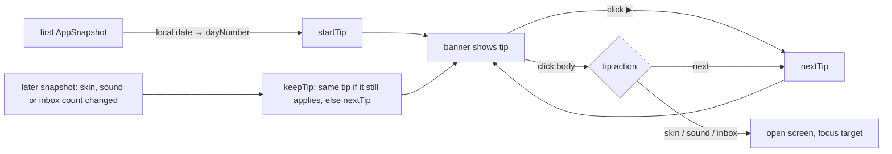

# Design: Retro skin

## Overview

The skins keep their mechanism from the themes spec: one `theme` value in the settings file, `data-theme` on `<html>`, one token file per skin, sprite modules by role. This spec replaces the token values and the stylesheets that use them, swaps Jua for Galmuri, adds pixel icons and hair, and changes three pieces of markup: the tabs become a toolbar, the footer becomes a status bar, and a TIP banner sits above it.

The only new logic is small and pure: the tip list and its choice in `src/core/tips.ts`, the toolbar's arrow keys in `src/ui/model/toolbar.ts`, and the banner view in `src/ui/model/banner.ts`. The only new stored value is `hideBanner`, a sixth boolean setting that rides on the existing `ui:setting` channel. The main process changes in two lines (the setting key list and the settings file), and the controller not at all.



No timer touches the banner. `setInterval(render, 30 s)` in `main.ts` (ages like `2m`) re-renders it with the same tip, because `keepTip` returns the shown tip while it applies.

## Architecture

```
src/core   tips.ts (new): TIPS, TipId, TipContext, dayNumber, applicableTips, startTip, nextTip, keepTip, tipText   pure
           snapshot.ts: PublicSettings.hideBanner
src/app    settings.ts (hideBanner default, parse, serialize), ipc.ts (SETTING_KEYS gains hideBanner)
src/ui     index.html: toolbar markup, banner slot, screens as labelled regions
           chrome.ts: title bar mark per skin, toolbar (icons, pressed, count, roving tabindex), status bar panels
           model/toolbar.ts (new): rovingTarget()          model/banner.ts (new): bannerView()
           model/chrome.ts: footer() → statusPanels()      model/theme.ts → model/skin.ts (tiles, note, order)
           screens/banner.ts (new); screens/list.ts, me.ts, inbox.ts, settings.ts, popup.ts
           sprites/types.ts (roles), blue-bot.ts (title body role), strawberry-milk.ts (hair, new faces),
           sprites/icons.ts (new: check, pencil, boxes, strawberry, toolbar icons), render.ts (sizes, badge check)
           styles/themes/*.css (new token values), fonts.css, main.css, list.css, inbox.css, settings.css,
           popup.css, sprites.css, materials.css (new: raised, sunken, gloss, selection, focus rules)
src/ui/public/fonts   + Galmuri11.woff2, Galmuri11-Bold.woff2, Galmuri9.woff2, OFL-Galmuri.txt; − Jua-Regular.ttf, OFL-Jua.txt
tests      font-cmap.ts (new helper), tips tests, toolbar tests, banner tests; contrast, themes, sprites, ui-build updated
```

Import rules stay those of structure.md. `src/core/tips.ts` imports only `core/theme.ts` types. `sprites/icons.ts` imports only `sprites/types.ts`-style local types. No new file reaches the file system or network; no new IPC channel.

## Order of work

1. Galmuri, after the builder's OK to download; the character-map record (needed by the glyph decisions and the font test).
2. Core (`tips.ts`) and the `hideBanner` setting, with their tests.
3. Tokens, fonts and materials; sprites and pixel icons.
4. Chrome (title bar, toolbar, status bar), banner, then the screens and the pop-up.
5. Contrast and the other tests; the mutation check.
6. The screen check with the builder; then README, steering and the final checkpoint.

## Fonts (Req 3)

**Download** (only after the builder's OK, Req 3.1). One command, run once:

```
npm pack galmuri@2.40.3 --pack-destination "$TMP"
```

`npm pack` fetches the tarball from the npm registry and checks it against the registry's `integrity` (sha512); its output names the tarball and the integrity, which go into the tasks. The agent then lists the tarball (`tar -tzf`), extracts only the three woff2 files and the license, and copies them to `src/ui/public/fonts/` as:

| File in the repo | From the package | Note |
|---|---|---|
| `Galmuri11.woff2` | the Galmuri11 Regular woff2 | 400 |
| `Galmuri11-Bold.woff2` | the Galmuri11 Bold woff2 | 700 |
| `Galmuri9.woff2` | the Galmuri9 woff2 | 400 |
| `OFL-Galmuri.txt` | `LICENSE.txt`, byte for byte | named like the other license files |

The paths inside the package are UNVERIFIED until the tarball is listed; the tasks record them. The license must read `SIL OPEN FONT LICENSE Version 1.1`; if it does not, the agent stops and asks. The temp folder is deleted afterwards. Nothing is added to `package.json` (the fonts are vendored like Nanum Gothic). Jua and `OFL-Jua.txt` are deleted.

**`fonts.css`**: `@font-face` for `Galmuri11` (400 and 700) and `Galmuri9` (400), `font-display: block`, `format('woff2')`; Nanum Gothic's three faces stay; Jua's rule goes.

```css
:root {
  --font-text: 'Galmuri11', 'Nanum Gothic', sans-serif;   /* 12 px, all UI text */
  --font-small: 'Galmuri9', 'Nanum Gothic', sans-serif;   /* 10 px: status bar, times, notes, counters, badges, toolbar labels */
}
html { -webkit-font-smoothing: none; }
```

`--font-title` is removed; every use becomes `--font-text` (titles are bold Galmuri11).

**Character maps** (Req 3.8). `tests/unit/font-cmap.ts` reads a woff2 file without a dependency: it parses the WOFF2 header and table directory (UIntBase128 lengths, known-tag flags), decompresses the single Brotli stream with `zlib.brotliDecompressSync`, finds `cmap` (never transformed in WOFF2) by summing the stored lengths of the tables before it, and reads its format 4 and 12 subtables into a `Set<number>` of code points. After the download, a one-time run of that helper over the UI's character set (below) gives the fallback record, which is written into `fonts.css`'s comment and into `src/ui/fallback.ts`:

```ts
/** Characters the UI can show that a bundled Galmuri file lacks (cmap read <date>), by file. */
export const GALMURI_MISSING = { regular: '…', bold: '…', small: '…' } as const;
```

The brief's finding (`✓ ✎` in all three, `▸ −` in Bold) is expected to reappear there; the rest is filled from the run.

**The UI's character set**, used by the record and by the test: every character of the string literals in `src/ui/**/*.ts`, `src/core/text.ts` and `src/core/tips.ts`; the text of `index.html` and `popup.html`; and every quoted `content` token value in the skin token files. Agent text (prompts, replies, folder names) and the user's status message are not part of it: they can hold any character and always fall back per character.

## Core

### `src/core/tips.ts` (Req 9)

```ts
export const TIP_IDS = ['skin-blue-bot', 'skin-strawberry-milk', 'click-buddy', 'sound', 'unread', 'hide-sessions'] as const;
export type TipId = (typeof TIP_IDS)[number];
export type TipAction = 'skin' | 'sound' | 'inbox' | 'next';
export interface TipContext { theme: ThemeId; sound: boolean; unread: number }
export interface TipText { headline: string; body: string; berry: boolean }   // berry: the pixel strawberry after the body

export function dayNumber(year: number, month: number, day: number): number;   // Math.floor(Date.UTC(year, month - 1, day) / 86_400_000)
export function applies(id: TipId, c: TipContext): boolean;
export function applicableTips(c: TipContext): TipId[];                        // TIP_IDS order, filtered
export function startTip(day: number, c: TipContext): TipId;                   // applicable[mod(day, n)]
export function nextTip(current: TipId, c: TipContext): TipId;                 // the first applicable tip after `current` in TIP_IDS order, wrapping
export function keepTip(current: TipId, c: TipContext): TipId;                 // applies(current) ? current : nextTip(current, c)
export function tipAction(id: TipId): TipAction;
export function tipText(id: TipId, c: TipContext): TipText;
```

| ID | Applies when | Headline | Body | Action |
|---|---|---|---|---|
| `skin-blue-bot` | `theme === 'strawberry-milk'` | `★ NEW! Blue Bot skin ★` | `try it now~ click here`, `berry: true` | `skin` |
| `skin-strawberry-milk` | `theme === 'blue-bot'` | `★ NEW! Strawberry Milk skin ★` | `try it now~ click here` | `skin` |
| `click-buddy` | always | `TIP ▶ click a buddy` | `to jump straight to its window~` | `next` |
| `sound` | `sound` | `Too many dings?` | `turn the sound off here` | `sound` |
| `unread` | `unread > 0` | `1 unread message waiting!` / `${n} unread messages waiting!` | `click to open your inbox` | `inbox` |
| `hide-sessions` | always | `Busy? hide old sessions` | `press × on a session row` | `next` |

- `click-buddy` and `hide-sessions` always apply, so `n ≥ 2` and `startTip` never divides by zero. `mod` is the non-negative remainder, so a day number before 1970 still gives an index.
- `Date.UTC` only turns calendar numbers into a count; it does not read the clock, so `tips.ts` stays pure (structure.md). The caller passes the local calendar date.
- `nextTip` starts from `current`'s position in `TIP_IDS` even when `current` no longer applies, so `keepTip` moves to the tip right after it (S15).

### `src/core/snapshot.ts`
`PublicSettings` gains `hideBanner: boolean`. `SettingKey` is derived from `PublicSettings`, so it gains `hideBanner` without an edit.

## App

### `settings.ts`, `ipc.ts` (Req 10)
- `DEFAULT_SETTINGS.hideBanner = false`.
- `SETTING_KEYS` (in `ipc.ts`) becomes `['hideText', 'sound', 'popups', 'macNotifications', 'alwaysOnTop', 'hideBanner']`. `parseSettings` already reads every key of that list only when its value is a boolean, so a missing, wrong-type or old value gives `false` with no new code. The `ui:setting` check already accepts only those keys with a boolean value (Req 10.3).
- `serializeSettings` writes `hideBanner` after `theme`.
- `controller.onSetting` needs no change: it saves and pushes state; `hideBanner` has no port effect.
- The browser source in `bridge.ts` sets `hideBanner: true` in its fixed settings, so the browser page has no banner even if a later change forgets the app-only check.

No other app file changes. The pop-up window size (`POPUP` 300 × 144) and its layout stay.

## UI

### Tokens (Req 2)

`styles/themes/blue-bot.css` and `styles/themes/strawberry-milk.css` are rewritten with the names below; both define every name. A gradient is never one token: each stop is its own hex token, so the contrast test can check every stop, and the component stylesheets build the gradient from them (`linear-gradient(var(--gloss-1) 0%, var(--gloss-2) 48%, var(--gloss-3) 52%, var(--gloss-4) 100%)`), which the themes test already allows.

| Token | Blue Bot | Strawberry Milk | Source |
|---|---|---|---|
| `--bg` | `#E6F0FC` | `#FDEFF5` | brief 2 |
| `--frame` / `--frame-inner` | `#1F4E9A` / `#A9D3FF` | `#B0326A` / `#FFC2DC` | brief 2 |
| `--radius-window` | `7px` (top corners; bottom 0 in `main.css`) | `7px` | brief 1 |
| `--gloss-1`…`--gloss-4` / `--gloss-top` | `#2B6FD0` `#2766C8` `#1E5BBE` `#2563C6` / `#8CC8FF` | `#FFD6E8` `#FFA6CB` `#F57FB2` `#FF96C2` / `transparent` | brief 2 |
| `--title-text` / `--title-shadow` | `#FFFFFF` / `#1D4E9A` | `#4A1A3E` / `#FFE6F1` | brief 2 |
| `--tbtn-from` / `--tbtn-to` / `--tbtn-glyph` / `--tbtn-line` | `#5697E8` / `#3A7FD8` / `#FFFFFF` / `#FFFFFF` | `#FFB8D6` / `#E5679E` / `#4A1A3E` / `#FFFFFF` | S1 |
| `--close-from` / `--close-to` / `--close-glyph` | `#E47647` / `#C8461A` / `#FFFFFF` | `#E0457F` / `#A3124A` / `#FFFFFF` | S1 |
| `--toolbar-bg` / `--toolbar-line` / `--toolbar-text` | `#D6E6FA` / `#9BB8E0` / `#173A78` | `#FBDCEA` / `#E3A9C5` / `#5A2D6E` | brief 2; text: mockups |
| `--bevel-light` / `--bevel-dark` / `--bevel-from` / `--bevel-to` / `--pressed` | `#FFFFFF` / `#5C7FB0` / `#FDFEFF` / `#DCEAFB` / `#CFE2F8` | `#FFFFFF` / `#C77BA0` / `#FFFDFE` / `#FBE2EE` / `#FBD3E4` | brief 2 |
| `--sunk-dark` / `--sunk-light` / `--sunk-inner` | `#7A9CC8` / `#FFFFFF` / `#B9CDE8` | `#C99AB5` / `#FFFFFF` / `#EBCFDD` | brief 2 |
| `--field` / `--panel` | `#F2F8FF` / `#FFFFFF` | `#FFF7FB` / `#FFFFFF` | brief 2; panel: mockups |
| `--box-line` | `#9BB8E0` | `#E3A9C5` | S2 |
| `--me-from` / `--me-to` / `--me-line` / `--me-name` / `--me-status` / `--me-hint` / `--me-field` / `--me-field-line` | `#FFFFFF` / `#E3EFFD` / `var(--box-line)` / `var(--text)` / `var(--text-2)` / `var(--text-2)` / `var(--panel)` / `var(--sunk-dark)` | `#FFFFFF` / `#FCE6F0` / … same aliases | mockups; MA 18.7 names kept |
| `--selection` / `--selection-text` | `#316AC5` / `#FFFFFF` | `#C2185B` / `#FFFFFF` | brief 2 |
| `--text` / `--text-2` / `--text-on-bg` | `#1B2B4F` / `#4E6290` / `#4E6290` | `#3B2A4A` / `#74647F` / `#5A4A68` | kept |
| `--group-text` | `#173A78` | `#5A2D6E` | mockups |
| `--line` | `#E3EEFC` | `#F3E6F0` | kept |
| `--tree` / `--tree-box` / `--tree-box-bg` | `#A9C3EA` / `#7A9CC8` / `#FFFFFF` | `#D9C2E8` / `#C99AB5` / `#FFFFFF` | brief 2 |
| `--alert-strip-bg` / `--alert-strip-line` / `--alert-strip-text` / `--alert-mark` | `#FFF1E4` / `#FF9A4D` / `#B4500F` / `"!"` | `#FFE8EF` / `#FF9EC4` / `#9B1C45` / `"!"` | kept; mark S13 |
| `--count-bg` / `--count-text` / `--count-line` | `#B84A0E` / `#FFFFFF` / `#FFFFFF` | `#C2185B` / `#FFFFFF` / `#FFFFFF` | kept; line: mockups |
| `--unread-mark` / `--unread-bg` / `--unread-color` / `--unread-select-line` | `"N"` / `#B84A0E` / `#FFFFFF` / `#FFFFFF` | `""` / `transparent` / `transparent` / `#FFFFFF` | Strawberry Milk draws the pixel strawberry instead; S5 |
| `--urgent-bg` / `--urgent-line` / `--unread-tint` | `#FFF4EA` / `#FF9A4D` / `var(--field)` | `#FFF0F5` / `#FF9EC4` / `var(--field)` | kept |
| `--banner-1` / `--banner-2` / `--banner-line` / `--banner-head` / `--banner-body` / `--banner-btn-dark` / `--banner-btn-bg` | `#173A78` / `#1E4B96` / `#1F4E9A` / `#FFE45C` / `#CFE8FF` / `#8EC2FF` / `rgba(255,255,255,.15)` | `#8E1043` / `#A3205A` / `#8E1043` / `#FFE45C` / `#FFE0EE` / `#FFB8D2` / `rgba(255,255,255,.15)` | brief 2; button: mockups |
| `--primary-from` / `--primary-to` / `--primary-light` / `--primary-dark` / `--primary-text` | `#3374D9` / `#2F6FD6` / `#8EC2FF` / `#173A78` / `#FFFFFF` | `#D43A73` / `#B0174F` / `#FFB8D6` / `#8E1043` / `#FFFFFF` | S1 |
| `--quiet-text` | `#173A78` | `#6B1E3F` | mockups |
| `--accent` | `#2F6FD6` | `#C2185B` | design.md |
| `--hard-shadow` | `rgba(0,0,0,.25)` | `rgba(90,45,110,.25)` | mockups |
| `--focus` / `--focus-on-gloss` / `--focus-on-dark` | `#2F6FD6` / `var(--title-text)` / `#FFFFFF` | `#C2185B` / `var(--title-text)` / `#FFFFFF` | S14 |
| `--st-*` | unchanged | unchanged | |
| `--glyph-work` / `--go-mark` / `--relay-mark` | `"▸"` / `"▶"` / `"●"` | `"♪"` / `"▶"` / `"●"` | design.md |
| `--badge-radius` / `--badge-line` / `--badge-outline` | `0` / `#FFFFFF` / `var(--frame)` | `50%` / `#FFFFFF` / `var(--frame)` | mockups |
| `--badge-wait`, `--badge-work`, `--badge-done`, `--badge-stale`, `--badge-idle`, `--badge-ended` | `"!"`, `"▸"`, `""`, `"?"`, `"z"`, `"×"` | `"!"`, `"♪"`, `""`, `"?"`, `"z"`, `"×"` | `✓` is a pixel icon |
| `--popup-radius` | `6px` | `6px` | mockups |
| `--popup-ok-1`…`4` / `--popup-ok-text` / `--popup-ok-shadow` / `--popup-ok-line` / `--popup-ok-close-bg` / `--popup-ok-tint` | `#FFC89A` `#FF9A5C` `#F58A4C` `#FF9450` / `#5A2200` / `#FFE0C8` / `var(--frame)` / `#A64A0A` / `#FFF4EA` | `#FFD6E8` `#FF9EC4` `#F2709F` `#FF8FB8` / `#4A1A3E` / `#FFE6F1` / `var(--frame)` / `#B0174F` / `#FFF0F5` | brief 2; ×, tints: mockups |
| `--popup-done-1`…`4` / `--popup-done-text` / `--popup-done-shadow` / `--popup-done-line` / `--popup-done-close-from` / `--popup-done-close-to` / `--popup-done-close-glyph` / `--popup-done-tint` | `var(--gloss-1)`…`var(--gloss-4)` / `#FFFFFF` / `#1D4E9A` / `var(--frame)` / `var(--tbtn-from)` / `var(--tbtn-to)` / `var(--tbtn-glyph)` / `#EAF4FF` | `#EAD9FF` `#C9A8F5` `#A985EA` `#BC9CF2` / `#2E1B5C` / `#F3EAFF` / `#6F4FB8` / `#5B3A9E` / `#5B3A9E` / `#FFFFFF` / `#F6F0FF` | brief 2; S3; line, tints: mockups |
| `--prog-text` / `--prog-done` / `--prog-current` / `--prog-todo` / `--prog-stripe-1` / `--prog-stripe-2` / `--prog-cells-display` / `--prog-bar-display` | `#1A5CC0` / `#36B9F0` / `#2F6FD6` / `#E3EEFC` / `#36B9F0` / `#36B9F0` / `grid` / `none` | `#5A2D6E` / `#FFB8D2` / `#D9C2FF` / `#FFF7FB` / `#FFB8D2` / `#D9C2FF` / `none` / `block` | brief 3; stripes kept |
| `--agent-claude`, `--agent-kiro`, `--agent-codex`, `--agent-me` / `--agent-banner` | unchanged / `#8EC2FF` | unchanged / `#FFB8D2` | banner: mockups |
| `--px-*` | see Sprites | see Sprites | |
| `--icon-1` / `--icon-2` / `--icon-paper` / `--icon-swatch-a` / `--icon-swatch-b` / `--icon-frame` | `#2F6FD6` / `#8B7BFF` / `#FFFFFF` / `#FFB8D2` / `#8EC2FF` / `#173A78` | `#C2185B` / `#A98BEA` / `#FFFFFF` / `#FFB8D2` / `#8EC2FF` / `#5A2D6E` | mockups |

Removed (Req 2.3): `--bg-pattern*`, `--frame-width`, `--title-from/to/line`, `--title-mark*`, `--tbtn-bg`, `--tbtn-radius`, `--close-bg/line`, `--on-fill` (replaced by the named white tokens), `--card-*`, `--group-bg`, `--group-radius`, `--group-off-*`, `--divider`, `--alert-strip-radius`, `--tab-*`, `--count-radius`, `--unread-radius/size/pad`, `--primary-bg/line/shadow`, `--quiet-bg/line`, `--button-radius`, `--relay-dot-size/radius`, `--popup-ok-from/to/frame`, `--popup-done-from/to/frame`, `--popup-done-close-bg/line`, `--popup-shadow`, `--prog-frame/track/radius/fill`, `--me-bg`, `--me-radius`, `--me-shadow`, `--me-line-width`, `--me-field-radius`, `--preview-*`, `--px-title-ink`, `--px-title-cheek`, `--px-me-cheek`.

`themes.css` keeps the import of both files, the opaque-frame rule (`--radius-window: 0px`, unused while `MAIN_FRAME` is transparent) and the hidden-page rule.

### Materials (Req 2.6): `styles/materials.css` (new)

Component-free rules that the screens use by class:

```css
.raised  { border: 1px solid; border-color: var(--bevel-light) var(--bevel-dark) var(--bevel-dark) var(--bevel-light);
           background: linear-gradient(var(--bevel-from), var(--bevel-to)); }
.raised[aria-current="page"], .raised:active, .raised[data-pressed]
         { border-color: var(--bevel-dark) var(--bevel-light) var(--bevel-light) var(--bevel-dark); background: var(--pressed); }
.sunken  { border: 1px solid; border-color: var(--sunk-dark) var(--sunk-light) var(--sunk-light) var(--sunk-dark);
           box-shadow: inset 1px 1px 0 var(--sunk-inner); }
.gloss   { background: linear-gradient(var(--gloss-1) 0%, var(--gloss-2) 48%, var(--gloss-3) 52%, var(--gloss-4) 100%);
           box-shadow: inset 0 1px 0 var(--gloss-top); color: var(--title-text); text-shadow: 1px 1px 0 var(--title-shadow); font-weight: 700; }
:focus-visible { outline: 2px solid var(--focus); outline-offset: 2px; }
.gloss :focus-visible { outline-color: var(--focus-on-gloss); }
.banner :focus-visible { outline-color: var(--focus-on-dark); }
.buddy-main:focus-visible { outline-color: var(--focus-on-dark); outline-offset: -2px; }  /* inset: the panel clips outside rings; the row is selected, so the ring sits on --selection */
```

The pop-up headers set `--focus-on-gloss` to their own text token (`popup.css`), so the × ring takes `#5A2200`, `#FFFFFF`, `#4A1A3E` or `#2E1B5C` (S14). Every `box-shadow` and `text-shadow` in the stylesheets has a blur of 0 (Req 2.5).

### Sprites (Req 4)

`sprites/types.ts`: roles `title-ink`, `title-cheek` and `me-cheek` go (no sprite uses them any more); new roles `hair`, `hair-hi`, `clip`, `grey-hair`, `grey-hair-hi`. `SpriteModule` gains `banner: readonly Pixel[]` (the mascot: the turn-done face with `body`), so both modules keep the same shape. `PIXEL_ROLES` follows.

| Role | Blue Bot | Strawberry Milk |
|---|---|---|
| `hair` / `hair-hi` / `clip` | `transparent` | `#8A5A44` / `#B07A5E` / `#E5466B` |
| `grey-hair` / `grey-hair-hi` | `transparent` | `#B9AEC4` / `#CFC6D8` |
| `title-body` | `#FFFFFF` (was `#3D8BFF`; `MainBot2000`) | `#FFFFFF` |
| `ink`, `tear`, `cheek`, `visor`, `acc-*`, `dim`, `grey-*` | unchanged | unchanged |

- `blue-bot.ts`: faces unchanged (`FacesBot`); `title` and `me` from `MainBot2000` (the title icon is the working face on a white body: `title-body` for the body and feet, `ink` (`#7DF9FF`) for the eyes, antenna tip, bolts and chest light, `visor` for the visor); `banner` from `MainBot2000`'s 28 px banner sprite (the done face, `body` = `--agent-banner`, star eyes and lights `acc-done`).
- `strawberry-milk.ts`: every face rewritten from `FacesCute2000` in its order (body, then hair, `hair-hi`, `clip`, then the face; grey hair and no clip for `OFFLINE` and `ENDED`); `title`, `me` and `banner` from `MainCute2000` (`title` with `title-body` and `ink`/`cheek`; `me` with `cheek` for its cheeks, `#FF8FB1` in the mockup).
- `render.ts`: `SpriteSize = 12 | 16 | 24 | 28 | 36`; `who` gains `'banner'`. `hasBadge` keeps its form with the threshold 24: agent sprites (not `me`, `title`, `banner`) with a state other than `OFFLINE` and `size >= 24`. In use that is exactly buddy rows (24), inbox rows (24) and pop-ups (36), and never session rows (12) or Skin tiles (16), so the place rule of Req 4.4 holds (S10); the test checks it by place. For `TURN_DONE` the badge holds the pixel check (below) instead of a `::before` glyph.
- `sprites.css`: `.sprite[data-agent="banner"] { --px-body: var(--agent-banner) }`; role fills for the new roles; badges `11px` at sizes 24, `13px` at 36, offset −3, `border: 1px solid var(--badge-line)`, `outline: 1px solid var(--badge-outline)`, `border-radius: var(--badge-radius)`, glyph Galmuri9 10 px, `font-weight: 400` (so `▸` never needs Bold).

### Pixel icons (Req 4.5, 4.6, 4.8): `sprites/icons.ts` (new)

```ts
export type IconName = 'check' | 'pencil' | 'box-open' | 'box-closed' | 'berry'
                     | 'tool-buddies' | 'tool-inbox' | 'tool-settings' | 'tool-skin';
export function icon(name: IconName, size: number): SVGSVGElement;   // createElementNS only, aria-hidden, focusable="false", crispEdges
```

Each icon is a grid of role rectangles; roles map to tokens in `sprites.css` (`.ic-ink { fill: currentColor }` and named roles for the rest), so `icons.ts` holds no color.

| Icon | Grid → drawn at | Rectangles (x, y, w, h, role) | Source |
|---|---|---|---|
| `berry` | 8 → 12 px (10 px in banner text) | `berry-leaf`: (2,0,1,1) (5,0,1,1) (1,1,6,1); `berry-red`: (0,2,8,1) (0,3,8,1) (0,4,8,1) (1,5,6,1) (2,6,4,1) (3,7,2,1); `berry-seed`: (1,3,1,1) (5,3,1,1) (3,4,1,1) (2,5,1,1) (6,4,1,1) | brief 4, `MainCute2000` |
| `tool-buddies` | 8 → 16 | `icon-1`: (2,0,3,3) (1,4,5,3); `icon-2`: (5,1,2,2) (5,4,3,3) | `MainBot2000` |
| `tool-inbox` | 8 → 16 | `icon-paper`: (0,1,8,6); `icon-1`: (0,1,8,1) (0,6,8,1) (0,1,1,6) (7,1,1,6) (1,2,1,1) (2,3,1,1) (3,4,2,1) (5,3,1,1) (6,2,1,1) | `MainBot2000` |
| `tool-settings` | 8 → 16 | `icon-1`: (3,0,2,8) (0,3,8,2) (1,1,6,6); `icon-paper`: (3,3,2,2) | `MainBot2000` |
| `tool-skin` | 8 → 16 | `icon-swatch-a`: (1,1,6,6); `icon-swatch-b`: (1,1,3,3) (4,4,3,3); `icon-frame`: (0,0,8,1) (0,7,8,1) (0,0,1,8) (7,0,1,8) | `MainBot2000` |
| `check` | 7 → 7 px | `ink`: (6,0,1,1) (5,1,1,1) (4,2,1,1) (0,2,1,1) (1,3,1,1) (3,3,1,1) (2,4,1,1) | new (no mockup draws it) |
| `pencil` | 7 → 7 px | `ink`: (5,0,2,1) (4,1,3,1) (3,2,3,1) (2,3,3,1) (1,4,3,1) (0,5,2,1) (0,6,1,1) | new |
| `box-open` (`[−]`) | 9 → 9 px | `tree-box`: (0,0,9,1) (0,8,9,1) (0,1,1,7) (8,1,1,7); `tree-box-bg`: (1,1,7,7); `ink`: (2,4,5,1) | new, the mockups' 9 px box |
| `box-closed` (`[+]`) | 9 → 9 px | as `box-open`, plus `ink` (4,2,1,5) | new |

`check`, `pencil` and the boxes have no mockup pixels (the mockups draw them as characters), so their rectangles are designed here and, when the builder approves this design, written into design.md "Buddy sprites" so that Req 4.10 ("only the mockups and design.md") holds. The `berry` roles are `transparent` in Blue Bot, which never draws a berry. `check` is drawn at 1 px per cell inside the badge (white, `currentColor`), in the status bar's `on top` panel, and nowhere else.

### Title bar (Req 5)

`index.html`: `.titlebar` gets `class="titlebar gloss"`; `.title-mark` becomes an empty slot. `chrome.ts` fills `.tb-sprite` with `sprite(theme, 'title', null, 16)` and the slot with `icon('berry', 12)` in Strawberry Milk, nothing in Blue Bot (S9), whenever the skin changes. The buttons keep their markup and glyphs (`▲ _ ×`); `main.css` gives them 19 × 17 px, radius 3, `1px solid var(--tbtn-line)`, `linear-gradient(var(--tbtn-from), var(--tbtn-to))`, glyph `var(--tbtn-glyph)`, and the close button the `--close-*` tokens.

### Toolbar (Req 6)

`index.html` replaces the tab list:

```html
<div class="toolbar" role="toolbar" aria-label="Screens">
  <button type="button" class="tool raised" data-tool="list" data-focus="tool:list"><span class="tool-icon"></span><span class="tool-label">Buddies</span></button>
  <button type="button" class="tool raised" data-tool="inbox" data-focus="tool:inbox"><span class="tool-icon"></span><span class="tool-label">Inbox</span><span class="tool-count" hidden></span></button>
  <button type="button" class="tool raised" data-tool="settings" data-focus="tool:settings"><span class="tool-icon"></span><span class="tool-label">Settings</span></button>
  <button type="button" class="tool raised" data-tool="skin" data-focus="tool:skin"><span class="tool-icon"></span><span class="tool-label">Skin</span></button>
</div>
<main class="screen screen-list" aria-label="Buddies"></main>
<section class="screen screen-inbox" aria-label="Inbox" hidden></section>
<section class="screen screen-settings" aria-label="Settings" hidden></section>
```

The toolbar moves above the me row (Req 7.1). `.tool-count` is the square badge with `aria-hidden` digits followed by an `.sr-only` ` unread`, as the tab's count was.

`model/toolbar.ts` (pure):

```ts
export const TOOLS = ['list', 'inbox', 'settings', 'skin'] as const;
export type Tool = (typeof TOOLS)[number];
/** The button index a key moves focus to, or null for any other key. */
export function rovingTarget(key: string, index: number, count: number): number | null;
// ArrowRight: (index + 1) % count; ArrowLeft: (index - 1 + count) % count; Home: 0; End: count - 1
export interface ToolVM { tool: Tool; current: boolean; tabIndex: 0 | -1 }
/** Per button: `aria-current` and tab stop. The roving index moves to the open screen's button only when the screen changed. */
export function toolbarView(tab: Tab, previousTab: Tab | null, rovingIndex: number): { tools: ToolVM[]; rovingIndex: number };
/** The focus target `Skin` opens: the checked skin radio. */
export const skinFocusId = (theme: ThemeId): string => `theme:${theme}`;
```

The DOM side in `chrome.ts` only applies `toolbarView` and `rovingTarget`, so their behavior is tested without a DOM (the tests read no DOM library; see Tests).

`chrome.ts`:
- `setupChrome` adds one `keydown` listener on `.toolbar`: for a key with a `rovingTarget`, it calls `preventDefault`, sets `tabIndex = -1` on every button and `0` on the target, and focuses it. Enter and Space are the native button activation, so they need no handler.
- A `click` on `list`, `inbox` or `settings` calls `setTab`; on `skin` it calls `openSkin()` (below).
- `renderChrome` sets `aria-current="page"` on the open screen's button only. When the open screen differs from the last render, it moves `tabIndex = 0` to that button; otherwise it leaves the roving index where the user put it, so a re-render never takes the arrow-key position away.
- Icons are filled once per skin change (`icon('tool-…', 16)`).

Moving to a screen with a focus target (`main.ts`):

```ts
function openScreen(t: Tab, focusId?: string): void {
  tab = t;
  render();
  if (focusId === undefined) return;
  const target = document.querySelector<HTMLElement>(`[data-focus="${focusId}"]`);
  target?.scrollIntoView({ block: 'nearest' });
  target?.focus();
}
const openSkin = () => openScreen('settings', `theme:${snap!.settings.theme}`);   // Req 6.4
const openSound = () => openScreen('settings', 'set:sound');                       // tip `sound`
```

`focusId` values are the existing `data-focus` attributes, which are fixed strings, never agent text.

### Buddies screen (Req 7)

- **Me row** (`screens/me.ts`, `main.css`): background `linear-gradient(var(--me-from), var(--me-to))`, `1px solid var(--me-line)`; the 36 px `me` sprite in a `.sunken` frame (2 px padding, `--field`); `me` bold and ` (online)` regular in `--st-work`; the status button gets `.sunken` with `--me-field`; the ` ✎` text is replaced by `icon('pencil', 7)` in `--me-hint`.
- **Alert strip**: `1px solid var(--alert-strip-line)`, no radius, `.alert-mark` with `!`.
- **List panel**: `.screen-list` gets `.sunken` and `--panel`.
- **Group head** (`screens/list.ts`): the caret text `▼` / `▶` is replaced by `icon(g.open ? 'box-open' : 'box-closed', 9)`; the count becomes `(online/total)` for folders with `<span class="sr-only"> online</span>` after it, and `(total)` for the offline group as today. No fill; name bold `--group-text`; the offline group's name `--st-off`.
- **Rows**: sprites 24 px (buddy) and 12 px (session); the tree mark `└` (the model's `tree` value becomes `└`); ages in `--font-small`.
- **Unread marker**: `unreadMark(theme)` returns, for Blue Bot, today's `.unread-mark` (`N` from `--unread-mark`) plus `.sr-only` `unread`; for Strawberry Milk a `<span class="unread-mark" role="img" aria-label="new">` holding `icon('berry', 12)` (Req 4.6).
- **Selection** (Req 7.6): `main.ts` keeps `selected: string | null` (a buddy key). The buddy click handler sets it before calling `bridge.click`, so the click still acknowledges and jumps as before. `renderList` gets `selected` and sets `data-selected` on that buddy's `.buddy-main`; when no group holds that key any more, `main.ts` sets `selected = null`. CSS:

  ```css
  .buddy-main:focus-visible,
  .screen-list:not(:has(.buddy-main:focus-visible)) .buddy-main[data-selected] {
    background: var(--selection); color: var(--selection-text);
  }
  /* inside a selected row: every text white, state colors dropped, marker framed (S5) */
  ```

  The phrase, excerpt, count, `n/m` and age spans inside it take `color: inherit`; `.unread-mark` gets `outline: 1px solid var(--unread-select-line)`.
- **Progress**: `.progress` becomes `.sunken` on `--field`; cells 7 px high with a 1 px gap; the Strawberry Milk bar 9 px with `repeating-linear-gradient(135deg, var(--prog-stripe-1) 0 4px, var(--prog-stripe-2) 4px 8px)`. The model is unchanged.

### Status bar (Req 8)

`model/chrome.ts`: `footer()` becomes

```ts
export interface StatusPanel { text: string; dot?: Dot; check?: boolean; grow?: boolean }
export function statusPanels(s: AppSnapshot, tab: Tab, notice?: string): StatusPanel[] | null;
```

- Buddies: `{ dot, text, grow }` from `relayStatus` (whose connected text becomes `relay connected`) or the notice; then `{ text: 'local only' }` when connected; then `{ text: 'on top', check: true }` in the app while always-on-top is on.
- Inbox: `kept on this computer only`, `click a message to go there`.
- Settings: `null`.

`chrome.ts` draws each as a `<span class="panel sunken">`; the dot is `.relay-mark` (`--relay-mark`, colored by `data-dot` as today); `check` appends `icon('check', 7)` after a space. `connections()` in Settings keeps using `relayStatus` dots; its lines are unchanged.

### TIP banner (Req 9)

`model/banner.ts` (pure):

```ts
export interface BannerVM { id: TipId; headline: string; body: string; berry: boolean; action: TipAction }
/** null when the banner is not shown: browser, not the Buddies screen, or hideBanner. */
export function bannerView(s: AppSnapshot, tab: Tab, tip: TipId): BannerVM | null;
export function tipContext(s: AppSnapshot): TipContext;   // { theme, sound, unread: unreadCount(s.inbox) }
```

`main.ts` state: `let tip: TipId | null = null`.
- In `onSnapshot`: when `tip === null` and the mode is not `browser`, `const d = new Date(); tip = startTip(dayNumber(d.getFullYear(), d.getMonth() + 1, d.getDate()), tipContext(s))` (Req 9.3). Otherwise `tip = keepTip(tip, tipContext(s))` (Req 9.7). Both run before `render()`.
- `nextTip` runs only in the two click handlers.

`screens/banner.ts` renders into `<div class="banner" hidden>` (in `index.html`, after `.screen-list`, before `.statusbar`):

```html
<div class="banner">
  <span class="sprite" data-agent="banner">…28 px…</span>
  <button type="button" class="banner-main" data-focus="banner:main">
    <span class="banner-head">★ NEW! Blue Bot skin ★</span>
    <span class="banner-body">try it now~ click here [berry]</span>
  </button>
  <button type="button" class="banner-next" aria-label="Next tip" data-focus="banner:next">▶</button>
</div>
```

The accessible name of `.banner-main` is its text (headline, then body; the berry is `aria-hidden`). Clicks: `.banner-main` runs the action (`next` → `nextTip`; `skin` → `openSkin()`; `sound` → `openSound()`; `inbox` → `openScreen('inbox')`); `.banner-next` → `nextTip`. Both call `render()`; with `keepFocus` and the fixed `data-focus`, focus stays on the button the user pressed. Nothing goes to the bridge (Req 9.10). Text goes in with `textContent` (Req 9.11).

Look: 44 px high, `repeating-linear-gradient(90deg, var(--banner-1) 0 2px, var(--banner-2) 2px 4px)`, `1px solid var(--banner-line)`, 8 px side padding; headline bold `--banner-head`; body `--font-small` `--banner-body`; `▶` 20 × 20 with `border-color: var(--bevel-light) var(--banner-btn-dark) var(--banner-btn-dark) var(--bevel-light)` on `--banner-btn-bg`, white glyph (`--focus-on-dark`).

### Inbox (Req 12.1)
`screens/inbox.ts`: rows inside a `.sunken` `--panel` box; sprites 24 px; `unreadMark(theme)` as in the list; `Mark all read` gets `.raised` and `--quiet-text`; times in `--font-small`. Row content, order and clicks unchanged.

### Settings (Req 1, 10.4, 12.2, 12.3)

`model/theme.ts` becomes `model/skin.ts`: `skinTiles(current)` in the order of `SkinPicker2000` (Blue Bot, then Strawberry Milk), `SKIN_NOTE` (the note text, unchanged), `BANNER_NOTE = 'Tips are built in. Nothing is downloaded.'`.

`screens/settings.ts`:
- every card becomes `<fieldset class="set-group"><legend>Title</legend>…</fieldset>`; `set-title` headings go;
- order: Skin, Banner, Window, When an agent needs you, Privacy, Connections;
- Skin: `<fieldset class="set-group set-skin"><legend id="skin-title">Skin</legend><div role="radiogroup" aria-labelledby="skin-title">` with the two tiles. Each tile is `<label class="skin-tile raised">` holding the mini window (`data-theme-preview`, frame, gloss strip, a sunken white row with `sprite(id, 'claude', 'WORKING', 16)` and a 5 px bar), then a row with the native radio (now visible, `accent-color: var(--accent)`) and the skin name. The checked tile gets `data-pressed`. The `✓` after the name goes. Input `name="skin"`, `data-focus="theme:<id>"` (kept, so `openSkin` and `keepFocus` find it);
- Banner: one checkbox row `['hideBanner', 'Hide the TIP banner']`, note `BANNER_NOTE`;
- checkboxes `accent-color: var(--accent)`; notes `--font-small` `--text-on-bg`; legends bold `--group-text`; `border: 1px solid var(--box-line)`, radius 3, `box-shadow: inset 1px 1px 0 var(--bevel-light)`.

**Skin naming** (Req 1): the user-facing strings that change are the legend `Skin` (was the card title `Theme`), the radio group name (from the legend), the toolbar label, and the README. `THEME_NAMES` keeps its content; its comment says Skin. A unit test scans the UI's string literals, `index.html`, `popup.html` and the built `index.html` for `/\btheme\b/i` in user-facing text (text nodes, `aria-label`, `title`, string literals passed to `el(…, text)`), excluding identifiers, `data-theme`, CSS and comments.

### Pop-ups (Req 11)

`popup.html` keeps its markup; `.card-title` gets `class="card-title gloss"`. `popup.css`:
- `.card`: `1px solid` the kind's `--popup-*-line`, `border-radius: var(--popup-radius) var(--popup-radius) 0 0`, `box-shadow: 2px 2px 0 var(--hard-shadow)`; it fills the 300 px window less 2 px on the right and bottom for the shadow (S11), placed at the bottom of the window;
- header: the kind's four stops, text and shadow tokens, `--focus-on-gloss: var(--popup-*-text)`; time `--font-small`; × 17 × 15, radius 3, `1px solid var(--tbtn-line)`, the kind's close tokens (needs-OK flat `--popup-ok-close-bg`; turn-done gradient `--popup-done-close-from/to`);
- body `linear-gradient(var(--panel), var(--popup-*-tint))`, the 36 px sprite in a `.sunken` `--field` frame, `@ folder` `--font-small`;
- actions on `--popup-*-tint`: `Later` `.raised` with `--quiet-text`; `Go there` with `--primary-*` (gradient, light top-left and dark bottom-right border, bold white) and `.go-mark` `▶`;
- the notice kind uses the turn-done tokens.

`screens/popup.ts` changes only the sprite size (44 → 36). The click handler is untouched (Req 11.1). The card's height (header 21 + body 58 + actions 29 + borders 2 + shadow 2 = 112 px) fits the 144 px window.

### Contrast (Req 13)

`tests/unit/contrast.test.ts` is rewritten for the new token names. Every gradient pair lists all its stops. Text pairs need 4.5:1, graphics 3:1. Values measured for this design (lowest–highest over the listed backgrounds):

| Foreground | On | Kind | Blue Bot | Strawberry Milk |
|---|---|---|---|---|
| `--text` | `--bg`, `--panel`, `--field`, `--me-to`, `--urgent-bg`, both pop-up tints | text | 11.98–13.95 | 10.96–12.99 |
| `--text-2` | `--panel`, `--field`, `--me-to`, `--urgent-bg`, both pop-up tints | text | 5.19–6.05 | 4.58–5.42 |
| `--text-on-bg` | `--bg` | text | 5.25 | 7.21 |
| `--group-text` | `--panel`, `--bg`, `--bevel-from`, `--bevel-to`, `--pressed` | text | 8.31–10.98 | 7.64–10.32 |
| `--toolbar-text`, `--quiet-text` | `--bevel-from`, `--bevel-to`, `--pressed` | text | 8.31–10.87 | 7.64–11.01 |
| `--title-text` | `--gloss-1`…`4` | text | 4.90–6.37 | 5.68–10.63 |
| `--primary-text` | `--primary-from`, `--primary-to` | text | 4.53–4.81 | 4.51–6.81 |
| `--selection-text` | `--selection` | text | 5.25 | 5.87 |
| `--alert-strip-text` | `--alert-strip-bg` | text | 4.63 | 6.82 |
| `--count-text` | `--count-bg` | text | 5.22 | 5.87 |
| `--unread-color` | `--unread-bg` (Blue Bot `N`) | text | 5.22 | — |
| `--banner-head`, `--banner-body` | `--banner-1`, `--banner-2` | text | 6.60–8.70 | 5.67–7.44 |
| `--popup-ok-text` | `--popup-ok-1`…`4` | text | 5.18–8.40 | 5.03–10.63 |
| `--popup-done-text` | `--popup-done-1`…`4` | text | 4.90–6.37 | 5.06–11.12 |
| `--prog-text` | `--panel` | text | 6.30 | 10.32 |
| each `--st-*` | `--panel` (rows) | text | 5.28–6.30 | 5.07–8.03 |
| `--st-wait` | `--urgent-bg`, `--popup-ok-tint` | text | 5.38 | 6.18 |
| `--st-done` | `--popup-done-tint` | text | 5.66 | 5.77 |
| `--st-work` | `--me-to` (`(online)`) | text | 4.60 | 4.53 |
| `--tbtn-glyph` | `--tbtn-from`, `--tbtn-to` | graphic | 3.01–4.03 | 4.48–8.67 |
| `--close-glyph` | `--close-from`, `--close-to` | graphic | 3.01–4.83 | 3.94–7.66 |
| `--popup-done-close-glyph` | `--popup-done-close-from`, `-to` | graphic | 3.01–4.03 | 8.26 |
| `--badge-line` (white glyph) | each `--st-*`, `--popup-ok-close-bg` | graphic | 5.28–6.30 | 5.07–8.03 |
| `--focus` | `--bg`, `--panel`, `--field`, `--toolbar-bg`, `--bevel-to`, `--pressed`, both pop-up tints | graphic | 3.64–4.81 | 4.35–5.87 |
| `--focus-on-gloss` | `--gloss-1`…`4` | graphic | 4.90–6.37 | 5.68–10.63 |
| `--focus-on-dark` | `--banner-1`, `--banner-2`, `--selection` | graphic | 5.25–10.98 | 5.87–9.11 |
| `--st-work` (relay dot) | `--field` | graphic | 5.01 | 5.10 |
| `--icon-1`, `--icon-frame` | `--bevel-from`, `--bevel-to`, `--pressed` | graphic | 3.64–10.87 | 4.35–10.19 |
| `--px-berry-red` (unread) | `--panel`, `--urgent-bg`, `--unread-tint` | graphic | — | 3.51–3.87 |
| `--unread-bg` (`N` tag) | `--panel`, `--urgent-bg`, `--unread-tint` | graphic | 4.82–5.22 | — |
| `--unread-select-line` | `--selection` | graphic | 5.25 | 5.87 |
| `--focus-on-dark` (`▶`) | `--banner-btn-bg` over `--banner-1`, `--banner-2` | graphic | 5.72–7.11 | 5.42–6.71 |

Known exceptions below 3:1, listed by name in the test (Req 13.2): `--icon-2` on the raised surfaces (2.05–2.70; the label under the icon says the same); the progress cells and stripes (TH D5); `--tree-box` on `--panel` (2.83 / 2.39; the folder name and `aria-expanded` say the same); the Skin tile previews (the skin name says the same). Decorative borders (frame, inner line, bevel and sunken edges, `--box-line`, `--line`, `--urgent-line`, `--tree`) carry no meaning and are not checked.

The test reads `--banner-btn-bg` as white at 15 % over each stripe (it is the only translucent color in the token files).

### Tests (Req 14)

| File | What |
|---|---|
| `tests/unit/tips.test.ts` (new) | each tip's condition; `startTip` for injected day numbers (`dayNumber(2026, 11, 13)` and its neighbors) and contexts; `nextTip` order, wrapping and skipping; `keepTip` after a skin change, sound off, inbox emptied; `1 unread message` / `2 unread messages`; `tips.ts` source holds no `Date.now`, `new Date(` or `performance` |
| `tests/property/tips.prop.test.ts` (new) | any day number (including negatives) and any context → the start tip applies, and is the same for the same inputs; pressing next `n` times from an applicable tip visits each applicable tip once and returns |
| `tests/unit/toolbar.test.ts` (new) | `rovingTarget` for every key and position (wrapping, Home/End, other keys `null`); `toolbarView`: exactly one `tabIndex = 0`, `aria-current` only on the open screen's button and never on `skin`, the roving index kept on a re-render and moved on a screen change; `skinFocusId` equals the `data-focus` the Skin radios get in `settings.ts`. Source checks, as the existing UI tests do (no DOM library in this repo): `index.html` has `role="toolbar"`, four `<button type="button">`s in the order Buddies, Inbox, Settings, Skin, no `role="tab"` or `tabpanel` left; `chrome.ts` handles `keydown` through `rovingTarget` and never calls `setTab` from it (moving focus opens nothing). Enter/Space are native button activation; the keyboard itself is tried in the screen check |
| `tests/unit/banner.test.ts` (new) | `bannerView` null in the browser, on Inbox and Settings, with `hideBanner`; headline, body, berry and action per tip; source checks: `screens/banner.ts` uses `textContent` only and does not reference the bridge, and `main.ts`'s banner handlers call only `nextTip`, `openScreen`, `openSkin`, `openSound` and `render` |
| `tests/unit/theme-setting.test.ts` | `hideBanner`: old files, missing, wrong types; `ui:setting` accepts it only as a boolean |
| `tests/property/theme.prop.test.ts` | `hideBanner` of any JSON value is a boolean, `true` only for `true`; settings round trip with `theme` and `hideBanner`; token sets equal (kept) |
| `tests/unit/themes.test.ts` | token sets equal; no color outside the token files (kept); no blurred `box-shadow` / `text-shadow` in any stylesheet; no user-facing "Theme" |
| `tests/unit/contrast.test.ts` | the table above |
| `tests/unit/sprites.test.ts` | Blue Bot faces vs `FacesBot`, title/me/banner vs `MainBot2000`; Strawberry Milk faces vs `FacesCute2000`, title/me/banner vs `MainCute2000`; berry and toolbar icons vs the mockups; badges by place; roles inside the grid; every role and icon role has a token in both skins |
| `tests/unit/ui-build.test.ts` | the fonts list: Nanum Gothic's three files, the three Galmuri files, `OFL-NanumGothic.txt`, `OFL-Galmuri.txt`, byte for byte, with the SHA-256 recorded in the tasks; no Jua; `@font-face` sources; no `http:` / `https:` |
| `tests/unit/fonts.test.ts` (new) | `font-cmap.ts` over the three bundled files: `GALMURI_MISSING` equals the computed missing set of the UI's character set, per file; `✓` and `✎` are not in the UI's character set (they are icons); `▸` appears only where CSS sets weight 400 (`.lead-work`, `.badge`) |
| `tests/unit/ui-model.test.ts`, `ui-theme.test.ts`, `ui-popup.test.ts` | updated for the status panels, the group count text, sprite sizes, the Skin tiles' order |

The existing controller, IPC, settings and pop-up behavior tests keep their assertions; only fixtures gain `hideBanner: false`. That they pass unchanged is the check that no other behavior moved.

**Mutation check** (Req 14.3), once while building, recorded in the tasks: (a) remove `--px-hair` from Blue Bot's token file; (b) set Blue Bot `--primary-from` back to `#5AA6F0`; (c) make `startTip` ignore `day` (always index 0); (d) make `rovingTarget` return `null` for `End`. Each alone, `npm test`, failing test names written down, then `git checkout -- <file>`.

### Screen check (Req 15.4)

Once, after the tests pass, as in TH task 8: announced right before with what appears and for how long; the app from this build with a temp `HOME` and port 4399 (its own relay), run in the foreground of the tool call with a fixed time limit; fake events with `/Users/dev/...` paths and no real prompts (a Kiro buddy with a temp `tasks.md`, a Claude buddy waiting, a Codex turn done), so all three screens, both skins, a selected row, the banner and both pop-up kinds show. The builder compares them with the `*2000` mockups and checks: Galmuri at 12 / 10 px, the hair, the berry, the pixel check and pencil, the toolbar with the keyboard, the focus rings on the title bar and banner. Afterwards: `pgrep` shows no process of this check, port 4399 is free, the temp home is deleted.

## Error handling

| Where | Failure | Behavior |
|---|---|---|
| settings file | `hideBanner` missing or not a boolean | `false`; other keys unaffected |
| `ui:setting` | `hideBanner` with a non-boolean value | dropped (existing check) |
| tips | a tip ID from an older build (none is stored) | not possible: tips live only in memory |
| banner | the shown tip stops applying | `keepTip` moves to the next applicable one |
| fonts | a character missing from Galmuri | falls back per character to Nanum Gothic, then the system font; recorded in `GALMURI_MISSING` |
| `openScreen` | the focus target is not in the DOM | the screen opens without moving focus |

## Known limits
- The brief's sizes put 12-cell sprites at 16 px (title bar, Skin tiles) and 28 px (banner), and the 8-cell berry at 12 px and 10 px. These are not whole multiples of the grid, so some pixel rows come out one screen pixel wider than others. 12, 24 and 36 px sprites and the 16 px toolbar icons are exact. The screen check looks at it.
- `●`, `★`, `▶`, `▲`, `└`, `♪`, `…` and `·` may be missing from Galmuri; the cmap record says which ones fall back.
- The transparent window's shadow and its 420 px minimum stay unverified (TH).

## Steering and README when implemented
- design.md: the pixel rectangles of `check`, `pencil`, `box-open` and `box-closed` (with this design's approval), the focus-ring rule (S14), the `keepTip` rule (S15) and the singular unread headline (S16).
- structure.md: `src/core/tips.ts`; `src/ui/model/toolbar.ts`, `model/banner.ts`, `model/skin.ts` (was `theme.ts`); `src/ui/screens/banner.ts`; `src/ui/sprites/icons.ts`; `src/ui/fallback.ts`; `styles/materials.css`; Galmuri in `public/fonts`.
- tech.md: the property list gains the tip and `hideBanner` properties.
- README: "skin" for the feature; the Banner setting; Galmuri in the font table in place of Jua; `app-settings.json` holds `hideBanner`.
