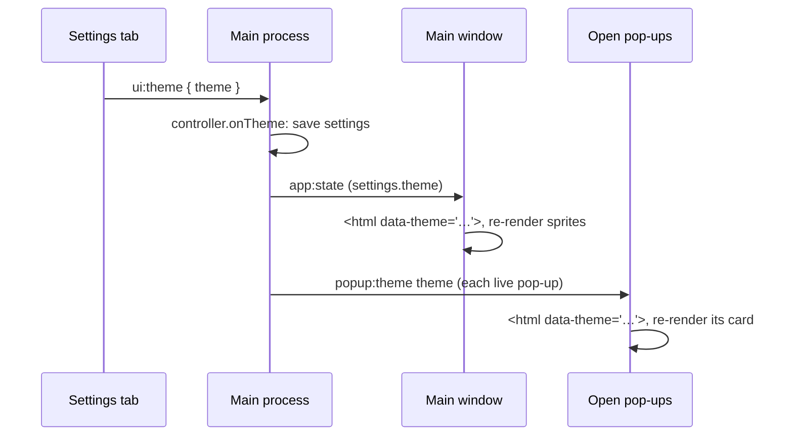

# Design: Themes

## Overview

A theme is one value in the settings file and one attribute on the root element. Everything a theme changes is a CSS custom property in one stylesheet, `src/ui/styles/themes.css`, in two blocks with the same names. Sprites are geometry in two TypeScript modules: each rectangle names a *role* (`body`, `visor`, `ink`, …), and the role's color is a token, so the modules hold no colors. The main process stores the theme, puts it into the URL of every window it opens, and sends a change to the main window (in the snapshot) and to every open pop-up (a new channel). No behavior of the messenger-app spec changes, apart from the three marked "behavior" in the requirements (T9, T10, T14).



## Architecture

```
src/core   theme.ts (new): ThemeId, THEMES, DEFAULT_THEME, isTheme, parseTheme      pure
           text.ts: WORKING phrases lose their glyph; StatusParts gains `lead`
           snapshot.ts: PublicSettings.theme
src/app    settings.ts, ipc.ts, controller.ts, controller-ports.ts, main.ts,
           windows.ts, popups.ts, preload-main.ts, preload-popup.ts, window-options.ts, config.ts
src/ui     styles/themes.css (replaces tokens.css), fonts.css, main.css, popup.css, sprites.css (replaces icons.css)
           sprites/blue-bot.ts, sprites/strawberry-milk.ts, sprites/types.ts, sprites/render.ts (new)
           theme.ts (new): apply the theme to <html>
           model/list.ts (progress cells), model/theme.ts (new: the two tiles)
           screens/*, chrome.ts, main.ts, bridge.ts
           icons.ts removed (state icons and the bubble are replaced by sprites)
src/ui/public/fonts   + Jua-Regular.ttf, OFL-Jua.txt; − Silkscreen-Regular.ttf, OFL-Silkscreen.txt
```

Import rules are those of the messenger-app spec. `src/core/theme.ts` imports nothing. The sprite modules import only `sprites/types.ts` and core types.

## Order of work

1. **O5, the transparent-window check (Req 8.1, 8.2).** It decides the main window's frame before anything is styled.
2. Jua, after the builder's OK to download.
3. Core, then app, then UI, then tests and the mutation check.
4. A visual check with the builder, then README and steering.

### O5: transparent main window

A throwaway Electron app in `scripts/o5/` (deleted once its result is recorded), started with the repository's Electron:
- one window: `frame: false`, `transparent: true`, `resizable: true`, `width`/`minWidth`/`maxWidth` 320, `height` 620, `minHeight` 420, `hasShadow: true`, `backgroundColor: '#00000000'`, the same `SECURE_PREFERENCES`; no relay, no tray, no pop-ups;
- its page (a `data:` free local file loaded with `loadFile`) draws a 3 px frame with a 16 px radius on all four corners, a 30 px title bar with `-webkit-app-region: drag`, and the text `drag the bottom edge · drag the title bar`;
- the main process writes every `resize` and `move` event with its bounds, and the window's `isResizable()`, to a log file (mode 600) under the system temp folder, and quits itself with `app.exit(0)` at 30 s.

The agent announces "지금 띄웁니다, 30초", starts it once in the background, waits for its exit inside the same tool call, confirms with `pgrep` that no Electron process of this repository is left (and kills it if one is), reads the log, and deletes the log and the script folder. The builder tries the bottom edge, the top edge and the title bar, and looks at the corners and the shadow.

Outcome:
- **transparent**: at least one `resize` event with a changed height, no height below 420, and the builder saw the corners clean. Then `MAIN_FRAME = 'transparent'`.

**Result (2026-11-13): `MAIN_FRAME = 'transparent'`.** Both edges resized the height and the title bar moved the window; the builder saw round corners. The shadow and the 420 px minimum were not checked (requirements, O5).
- **opaque**: anything else. Then `MAIN_FRAME = 'opaque'`.

The requirements record the date, the versions (Electron, macOS), the events seen and the builder's answers.

## Core

### `src/core/theme.ts` (Req 1)

```ts
export const THEMES = ['blue-bot', 'strawberry-milk'] as const;
export type ThemeId = (typeof THEMES)[number];
export const DEFAULT_THEME: ThemeId = 'blue-bot';
export const THEME_NAMES: Readonly<Record<ThemeId, string>> = { 'blue-bot': 'Blue Bot', 'strawberry-milk': 'Strawberry Milk' };
export function isTheme(v: unknown): v is ThemeId;     // exactly one of THEMES
export function parseTheme(v: unknown): ThemeId;      // isTheme(v) ? v : DEFAULT_THEME; never throws
```

### `src/core/text.ts` (Req 4.2, 4.6; T3, T14)

- `StatusParts` gains `lead?: 'work'`, set exactly when the state is `WORKING`. The screen draws the theme's working glyph from it.

### Phrase strings (T14, a behavior change)

Every string the core makes for a state, before and after:

| Constant | State | Before | After |
|---|---|---|---|
| `PHRASES.WAITING_APPROVAL` | `WAITING_APPROVAL` | `need your OK T_T` | unchanged |
| `PHRASES.WORKING` | `WORKING` | `♪ working…` | `working…` |
| `SPEC_TASK_PHRASE` | `WORKING`, Kiro in a spec task | `♪ studying hard` | `studying hard` |
| `PHRASES.STALE` | `STALE` | `? no news for a while` | unchanged |
| `PHRASES.TURN_DONE` | `TURN_DONE` | `★ done~ your turn!` | unchanged (`★` is the same in both themes) |
| `PHRASES.IDLE` | `IDLE` | `brb~ zZ` | unchanged |
| `PHRASES.OFFLINE` / `ENDED` | `OFFLINE` / `ENDED` | `offline` / `logged off` | unchanged |

On screen, the buddy row and the session row show `▸ working…` (Blue Bot) or `♪ working…` (Strawberry Milk): the glyph is a `::before` on a `.lead-work` span set from `lead`, followed by the core string.

Where the strings go, and what changes there:

| Place | Uses | Change |
|---|---|---|
| buddy rows, session rows (app and browser) | `statusParts`, `phraseOf` | the glyph moves from the string to CSS; what the user sees in Strawberry Milk is the same as today |
| pop-ups | `PHRASES[p.state]` with `p.state` an attention state (`WAITING_APPROVAL` or `TURN_DONE`) | none: never a `WORKING` phrase |
| macOS notifications | `PHRASES[p.state]`, attention states only | none |
| inbox screen | `need your OK` / `turn done` from `model/inbox.ts`, not `PHRASES` | none |
| `statusLine()` | tests only | its result for `WORKING` loses `♪ ` |
| tests | `status-line.test.ts` (the phrase table and `♪ studying hard`), `text.prop.test.ts` (P21), `ui-model.test.ts` (`♪ studying hard`, `♪ working…`) | updated to the new strings and to `lead` |

**Files written before this spec.** No stored file holds a phrase, so an old file cannot show the glyph twice:
- `inbox-YYYY-MM-DD.jsonl`: a `ping` record holds `at`, `session`, `buddyName`, `title`, `startedAt` and `state`; an `ack` record holds `at` and `session` (`validateInboxRecord` keeps nothing else). The screen builds every line from `state` at render time.
- `events-YYYY-MM-DD.jsonl` (relay): events hold the agent's own `text`, never a phrase; a relay of any age sends states, and the UI makes the phrase.
- `app-settings.json`: no phrase; `myStatus` is the user's own text.

A session title or status text that happens to start with `♪ working…` is agent text, shown as it is, never with a glyph added (the glyph comes only from `lead`). A unit test checks that `pingRecord` and `serializeSettings` output contains no value of `PHRASES` or `SPEC_TASK_PHRASE`.

### `src/core/snapshot.ts`
`PublicSettings` gains `theme: ThemeId`. `SettingKey` (the boolean settings) stays as it is.

## App

### `settings.ts` (Req 1.1–1.4, 1.6)
`DEFAULT_SETTINGS.theme = 'blue-bot'`. `parseSettings` sets `s.theme = parseTheme(value['theme'])`, so an old file (no `theme`) loads with every other key unchanged. `serializeSettings` writes `theme` after `alwaysOnTop`. Saving is unchanged: atomic, mode 600, coalesced within 500 ms.

### `ipc.ts`, preloads (Req 1.5, 2.5)

| Channel | Direction | Payload | Check |
|---|---|---|---|
| `ui:theme` | main window → main | `{ theme }` | `isTheme(theme)`; anything else is dropped |
| `popup:theme` | main → pop-up | `ThemeId` | |

`preload-main.ts` adds `setTheme(theme)`. `preload-popup.ts` adds `onTheme(cb)`, which keeps the last value like `onContent`.

### `controller.ts` (Req 2.6)
`onTheme(theme)`: when it equals the current theme, nothing; otherwise `setSettings({ ...settings, theme })`, `ports.applyTheme(theme)`, `update()`. `update()` already sends the count and the snapshot, which now carries the theme. Nothing else is called: no ping, no inbox record, no notice, no relay call. `Ports` gains `applyTheme(theme: ThemeId): void`.

### Delivering the theme (Req 2.4, 2.5, 2.7)

- **First frame.** `windows.ts` loads `app://ui/index.html?theme=<id>&frame=<MAIN_FRAME>`, and `popups.ts` loads `app://ui/popup.html?theme=<id>`. `protocol.ts` already resolves only `url.pathname`, so the query never reaches the file lookup. The first line of each page's script reads the query, checks it with `parseTheme`, and sets `data-theme` (and `data-frame`) on `<html>`. Until then `themes.css` hides the page: `html:not([data-theme]) body { visibility: hidden }`. The window is shown on `ready-to-show` as today, so at worst its first frame is empty, never the other theme.
- **Main window.** Each `app:state` carries `settings.theme`; `src/ui/theme.ts` sets `data-theme` when it differs, and the screens re-render (sprites are rebuilt for the theme).
- **Pop-ups.** `applyTheme` in `main.ts` calls `popups.setTheme(theme)`, which stores it for later pop-ups and sends `popup:theme` to every live pop-up. The pop-up page keeps its last content and fills the card again with the new theme's sprites. Bounds, timers and focus are not touched, so an open pop-up neither closes nor moves (Req 2.5).
- **Browser.** `bridge.ts` sets `blue-bot`, and the relay's page has no Settings tab (Req 2.8).

### `window-options.ts`, `config.ts` (Req 3.6, 8)
- `config.ts`: `MAIN_FRAME: 'transparent' | 'opaque'` (the O5 outcome), `POPUP.height` 144 (the new card: 3 px border, 30 px header, 62 px body, 40 px buttons, 3 px border, 4 px shadow, plus 2 px).
- `mainWindowOptions({ …, theme, frame })`: with `transparent`, `transparent: true`, `backgroundColor: '#00000000'`, `hasShadow: true`; with `opaque`, `backgroundColor: THEME_BACKGROUND[theme]`. `THEME_BACKGROUND` (`#EEF6FF`, `#FFF7FB`) is the one copy of the window background outside `themes.css`. It lives in `src/app`, not in the UI, and a unit test checks it against `--bg` of each block. On a theme change with an opaque window, `main.ts` also calls `setBackgroundColor`.

### `tray.ts`, `icon.ts`
Unchanged (Req 10).

## UI

### Tokens: `src/ui/styles/themes.css` (Req 3)

The only files with color values. Two blocks with the same names; to keep each file under about 200 lines (structure.md), each block lives in its own file, `styles/themes/blue-bot.css` and `styles/themes/strawberry-milk.css`, which `themes.css` imports (Vite inlines them in the build), and `themes.css` keeps the frame and hidden-page rules:

```css
:root[data-theme="blue-bot"], [data-theme-preview="blue-bot"] { --bg: #EEF6FF; … }
:root[data-theme="strawberry-milk"], [data-theme-preview="strawberry-milk"] { --bg: #FFF7FB; … }
:root[data-frame="opaque"] { --radius-window: 0px; }   /* Req 8.4 */
html:not([data-theme]) body { visibility: hidden; }
```

`[data-theme-preview]` lets a Theme card tile show the other theme inside the current one.

Token values, from design.md unless the Source column says otherwise. Strings in quotes are decoration characters.

| Token | Blue Bot | Strawberry Milk | Source |
|---|---|---|---|
| `--bg` | `#EEF6FF` | `#FFF7FB` | |
| `--bg-pattern-color` | `#DCEBFF` | `#FFDCEB` | |
| `--bg-pattern` | two 1 px `linear-gradient`s of `--bg-pattern-color` | `radial-gradient(var(--bg-pattern-color) 1.6px, transparent 1.8px)` | |
| `--bg-pattern-size` | `16px 16px` | `14px 14px` | |
| `--frame` / `--frame-width` / `--radius-window` | `#8EC2FF` / `3px` / `16px` | `#FF9EC4` / `3px` / `18px` | |
| `--title-from` / `--title-to` / `--title-text` / `--title-line` | `#A9D3FF` / `#CFE8FF` / `#173A78` / `#8EC2FF` | `#FFC2DC` / `#D9C2FF` / `#5A2D6E` / `#FFFFFF` | |
| `--title-mark` / `--title-mark-color` | `"▸"` / `#1A5CC0` | `"♡"` / `#8A4FB0` | mark: design.md; colors: mockups |
| `--tbtn-bg` / `--tbtn-line` / `--tbtn-glyph` / `--tbtn-radius` | `#FFFFFF` / `#8EC2FF` / `#2A4C8A` / `6px` | `#F7E9FF` / `#FFFFFF` / `#5A2D6E` / `11px` | |
| `--close-bg` / `--close-line` | `#B84A0E` / `#FFFFFF` | `#C2185B` / `#FFFFFF` | line: mockups |
| `--on-fill` | `#FFFFFF` | `#FFFFFF` | |
| `--card-bg` / `--card-line` / `--card-line-width` / `--card-shadow` / `--card-radius` | `#FFFFFF` / `#CFE3FF` / `1px` / `0 3px 0 #D3E4F8` / `12px` | `#FFFFFF` / `transparent` / `0px` / `0 2px 0 #F3C6DA` / `14px` | |
| `--group-bg` / `--group-text` / `--group-radius` | `#E3F0FF` / `#2A4C8A` / `8px` | `#F1E9FF` / `#4A2A5E` / `10px` | |
| `--group-off-bg` / `--group-off-text` | `#EDF3FB` / `#4E6290` | `#F5F1F8` / `#5A4A68` | mockups (D7) |
| `--text` / `--text-2` / `--text-on-bg` | `#1B2B4F` / `#4E6290` / `#4E6290` | `#3B2A4A` / `#74647F` / `#5A4A68` | `--text-on-bg`: D8 |
| `--line` | `#E3EEFC` | `#F3E6F0` | |
| `--divider` | `1px solid #E3EEFC` | `1px dashed #F0DDEA` | Strawberry Milk: mockup (D7) |
| `--tree` | `#A9C3EA` | `#D9C2E8` | |
| `--alert-strip-bg` / `--alert-strip-line` / `--alert-strip-text` / `--alert-strip-radius` / `--alert-mark` | `#FFF1E4` / `#FF9A4D` / `#B4500F` / `10px` / `"!"` | `#FFE8EF` / `#FF9EC4` / `#9B1C45` / `20px` / `"♥"` | mark: mockups |
| `--tab-active-bg` / `--tab-active-line` / `--tab-active-text` / `--tab-radius` | `#2F6FD6` / `#1F5BB8` / `#FFFFFF` / `8px` | `#FFFFFF` / `#FF9EC4` / `#3B2A4A` / `14px` | idle tabs use `--group-*` |
| `--count-bg` / `--count-radius` | `#B84A0E` / `4px` | `#C2185B` / `8px` | |
| `--unread-mark` / `--unread-bg` / `--unread-color` / `--unread-radius` / `--unread-size` / `--unread-pad` | `"N"` / `#B84A0E` / `#FFFFFF` / `3px` / `9px` / `0 3px` | `"♥"` / `transparent` / `#E5466B` / `0px` / `13px` / `0` | |
| `--urgent-bg` / `--urgent-line` | `#FFF4EA` / `#FF9A4D` | `#FFF0F5` / `#FF9EC4` | |
| `--unread-tint` | `#F2F8FF` | `#FFF7FB` | unread turn-done inbox rows; design.md names no tint, these are its quiet-btn and bg colors |
| `--primary-bg` / `--primary-line` / `--primary-shadow` / `--primary-text` | `#2F6FD6` / `#FFFFFF` / `0 3px 0 #2563C9` / `#FFFFFF` | `#C2185B` / `#FFFFFF` / `0 2px 0 #8E1043` / `#FFFFFF` | |
| `--quiet-bg` / `--quiet-line` / `--quiet-text` | `#F2F8FF` / `#CFE3FF` / `#2A4C8A` | `#FFF7FB` / `#F3C6DA` / `#6B1E3F` | |
| `--button-radius` | `8px` | `14px` | mockups |
| `--go-mark` | `"▶"` | `"♥"` | |
| `--focus` | `#2F6FD6` | `#C2185B` | |
| `--st-wait` / `--st-work` / `--st-done` / `--st-idle` / `--st-stale` / `--st-off` | `#A64A0A` / `#0F7A50` / `#1A5CC0` / `#7E5C00` / `#6A4DB8` / `#5E6C88` | `#B0174F` / `#13795B` / `#1F5FA8` / `#8A6A00` / `#5A4A68` / `#5A4A68` | `--st-off` also for `ENDED` |
| `--glyph-work` | `"▸"` | `"♪"` | |
| `--badge-radius` / `--badge-line` | `3px` / `#FFFFFF` | `50%` / `#FFFFFF` | |
| `--badge-wait`, `--badge-work`, `--badge-done`, `--badge-stale`, `--badge-idle`, `--badge-ended` | `"!"`, `"▸"`, `"✓"`, `"?"`, `"z"`, `"×"` | `"!"`, `"♪"`, `"✓"`, `"?"`, `"z"`, `"×"` | D1–D3 |
| `--relay-mark` / `--relay-dot-size` | `""` / `8px` | `"♥"` / `0px` | D7: a square dot or `♥` |
| `--popup-ok-from` / `--popup-ok-to` / `--popup-ok-text` / `--popup-ok-frame` | `#FFD3AE` / `#FFE6CC` / `#8A3A06` / `#FF9A4D` | `#FFC2DC` / `#FFD9C2` / `#6B1E3F` / `#FF9EC4` | |
| `--popup-done-from` / `--popup-done-to` / `--popup-done-text` / `--popup-done-frame` | `var(--title-from)` / `var(--title-to)` / `var(--title-text)` / `var(--frame)` | `#D9C2FF` / `#C2E3FF` / `#3D2A6B` / `#C9B2F5` | |
| `--popup-ok-close-bg` / `--popup-ok-close-glyph` | `var(--close-bg)` / `var(--on-fill)` | `var(--close-bg)` / `var(--on-fill)` | |
| `--popup-done-close-bg` / `--popup-done-close-glyph` / `--popup-done-close-line` | `var(--tbtn-bg)` / `var(--tbtn-glyph)` / `var(--tbtn-line)` | `var(--tbtn-bg)` / `var(--tbtn-glyph)` / `var(--tbtn-line)` | D8 |
| `--popup-shadow` | `0 4px 0 #D3E4F8` | `0 3px 0 #F3C6DA` | mockups |
| `--prog-text` | `#1A5CC0` | `#5A2D6E` | mockups (`n/m` in Jua 13 px) |
| `--prog-frame` / `--prog-track` / `--prog-radius` | `#BFD8FF` / `#F2F8FF` / `4px` | `#E7D5F2` / `#FBF6FE` / `6px` | |
| `--prog-done` / `--prog-current` / `--prog-todo` | `#36B9F0` / `#2F6FD6` / `#D6E6FA` | `#FFB8D2` / `#D9C2FF` / `#FBF6FE` | Strawberry Milk: its stripe colors, used by the bar |
| `--prog-fill` | `var(--prog-done)` | `repeating-linear-gradient(135deg, #FFB8D2 0 5px, #D9C2FF 5px 10px)` | |
| `--prog-cells-display` / `--prog-bar-display` | `grid` / `none` | `none` / `block` | Blue Bot draws cells, Strawberry Milk the bar |
| `--agent-claude` / `--agent-kiro` / `--agent-codex` / `--agent-me` | `#6C8CFF` / `#8B7BFF` / `#39C6E6` / `#2F6BFF` | `#FFC9A8` / `#CDB8FF` / `#A8EBD2` / `#FFB8D2` | |
| `--px-*` sprite roles | see Sprites | see Sprites | |
| `--me-bg`, `--me-line`, `--me-name`, `--me-status`, `--me-hint`, `--me-field`, `--me-field-line`, `--me-field-radius`, `--me-radius`, `--me-shadow` | the card tokens, `--text`, `--text-2`, `--focus`, `6px` | the same | MA 18.7 kept by name (Req 3.5) |

Font stacks stay in `fonts.css` as `--font-text` and `--font-title`; they are the same in both themes, so they are not theme tokens.

Messenger-app tokens that no theme uses any more (`--title-top`, `--button`, `--deep`, `--alert-top`, `--done-tint`, `--ring`, `--tile`, …) are removed with `tokens.css` (Req 3.5).

### Decoration characters (Req 4)
Every one is a `::before` on an empty `<span aria-hidden="true">`, with `content: var(--…)`:

| Element | Token | Next to |
|---|---|---|
| `.lead-work` | `--glyph-work`, then a space | the `working…` / `studying hard` phrase in buddy rows and session rows |
| `.badge` | `--badge-*` by `data-state` | state sprites of 26 px and larger, but not `OFFLINE` |
| `.go-mark` | `--go-mark` | `Go there` |
| `.title-mark` | `--title-mark` | `AgentBuddy` |
| `.unread-mark` | `--unread-mark` | the end of an unread buddy row and inbox row, followed by `<span class="sr-only">unread</span>` (Req 4.3) |
| `.alert-mark` | `--alert-mark` | the alert strip text |
| `.relay-mark` | `--relay-mark` (and a `--relay-dot-size` box) | the footer connection text, and the Settings connection lines |

None of these characters is in a DOM text node, so `textContent` checks, screen readers and copy-and-paste see only the words.

### Fonts (Req 5)
- Download once, with the builder's OK, from `https://raw.githubusercontent.com/google/fonts/main/ofl/jua/`: `Jua-Regular.ttf` and `OFL.txt` (saved as `OFL-Jua.txt`). Check that `METADATA.pb` says `license: "OFL"` and that the license text reads `SIL OPEN FONT LICENSE Version 1.1`; record the SHA-256 of both in the tasks, as in MA task 9.
- `fonts.css`: `@font-face` for `Jua` (400, `font-display: block`); Silkscreen's rule and files go. `--font-title: Jua, 'Nanum Gothic', sans-serif`.
- After the download, read Jua's `cmap` for `▸ ♡ ♥ ♪ ▶ ┗ ▼ ✓ ✎ ★`; anything it lacks falls back to Nanum Gothic, as Silkscreen did. The result goes into `fonts.css`'s comment.

**Glyph coverage (cmap read 2026-11-13, task 2.2):**

| Character | Jua | Nanum Gothic | Drawn by, in a Jua title |
|---|---|---|---|
| `♡` `♥` `★` `N` `!` `?` `z` `_`, Hangul (`띠링`) | yes | yes | Jua |
| `♪` `▶` `┗` `▼` `▲` `×` | no | yes | Nanum Gothic |
| `▸` `✓` `✎` | no | no | the system's fallback font |

Only the missing characters leave Jua: the title stack `'Jua', 'Nanum Gothic', sans-serif` makes the browser fall back per character, so `띠링! ♪ new message` keeps Jua for everything but `♪`. A `unicode-range` on Jua's `@font-face` was not needed for that. `▸` is Blue Bot's working glyph and title mark and is in neither bundled font, so on macOS it comes from a system font (which one is UNVERIFIED; task 8 looks at it). `✓` and `✎` were already drawn that way before this spec.

### Sprites (Req 6)

`src/ui/sprites/types.ts`:

```ts
export type PixelRole =
  | 'body' | 'ink' | 'tear' | 'cheek' | 'visor'
  | 'acc-wait' | 'acc-work' | 'acc-done' | 'acc-stale' | 'acc-idle' | 'dim'
  | 'grey-body' | 'grey-visor' | 'grey-ink'
  | 'title-body' | 'title-ink' | 'title-cheek' | 'me-cheek';
export interface Pixel { readonly x: number; readonly y: number; readonly w: number; readonly h: number; readonly role: PixelRole }
export interface SpriteModule {
  /** One face per displayed state; `body` pixels take the agent's color. */
  readonly faces: Readonly<Record<DisplayState, readonly Pixel[]>>;
  /** The 20 px title-bar icon and the 34 px `me` sprite (no badge). */
  readonly title: readonly Pixel[];
  readonly me: readonly Pixel[];
}
```

`blue-bot.ts` and `strawberry-milk.ts` each `export const sprites: SpriteModule`, the rectangles of the mockups in their order:
- faces: the seven 40 px sprites of `FacesBot` / `FacesCute`, in card order (`WAITING_APPROVAL`, `WORKING`, `TURN_DONE`, `STALE`, `IDLE`, `OFFLINE`, `ENDED`);
- title: the 20 px sprite of `MainBot` / `MainCute`; me: their 34 px sprite.

Role tokens (`--px-<role>`), from the mockup colors. A role a theme does not use is `transparent`, so both blocks define the same names:

| Role | Blue Bot | Strawberry Milk |
|---|---|---|
| `body` | the agent color (set per sprite, below) | the agent color |
| `ink` | `#7DF9FF` (LED eyes, idle bolts) | `#3B2A4A` (eyes, mouth) |
| `tear` | `#7CC4FF` | `#7CC4FF` |
| `cheek` | `transparent` | `#FF8FB1` |
| `visor` | `#1E2A4D` | `transparent` |
| `acc-wait` / `acc-work` / `acc-done` / `acc-stale` | `#FFB066` / `#5FE3A1` / `#FFE45C` / `#C7A6FF` | `transparent` |
| `acc-idle` / `dim` | `#FFD95C` / `#4F7FBF` | `transparent` |
| `grey-body` / `grey-visor` / `grey-ink` | `#B7C3D9` / `#8E9BB5` / `#5E6C88` | `#DDD6E3` / `transparent` / `#6E6078` |
| `title-body` / `title-ink` / `title-cheek` | `#3D8BFF` / `#7DF9FF` / `transparent` | `#FFFFFF` / `#5A2D6E` / `#FF8FB1` |
| `me-cheek` | `transparent` | `#FF6F9C` |

The Blue Bot done face uses `acc-done` for its star eyes, as the mockup does; the Strawberry Milk done face uses `ink`.

`src/ui/sprites/render.ts`:

```ts
export type SpriteSize = 16 | 20 | 26 | 34 | 44;
export function sprite(theme: ThemeId, who: AgentId | 'me' | 'title', state: DisplayState | null, size: SpriteSize): HTMLSpanElement;
```

It returns `<span class="sprite" data-agent data-size aria-hidden="true">` holding an `<svg viewBox="0 0 12 12" shape-rendering="crispEdges">` of `<rect class="px px-<role>">` built with `createElementNS` and `setAttribute` (Req 6.9), plus, when `state` is set, is not `OFFLINE`, and `size` is 26 or more, `<span class="badge" data-state>` (Req 6.5). `sprites.css` colors each role (`.px-visor { fill: var(--px-visor) }`) and sets `--px-body` from `data-agent` (`.sprite[data-agent="kiro"] { --px-body: var(--agent-kiro) }`). Neither the modules nor `render.ts` hold a color.

Badges (D1–D3, D11): absolutely placed at the bottom-right, size by sprite size (`26` → 12 px, offset −3; `44` → 18 px, offset −4, as the mockups; none on the 16 px session-row sprites, whose phrase names the state), `border: 1.5px solid var(--badge-line)`, `border-radius: var(--badge-radius)`, `background: var(--st-…)`, glyph `color: var(--on-fill)`, Nanum Gothic bold at 75 % of the badge size. The state's screen-reader name stays a separate `.sr-only` span, as today.

Sizes in place: 26 px buddy rows and inbox rows, 16 px session rows, 44 px pop-ups, 34 px `me`, 20 px title bar, 22 px in the Theme card tiles.

### Layout (Req 7)

`main.css` and `popup.css` are rewritten from `MainBot` / `MainCute` and `PopupBot` / `PopupCute`, using tokens only. The structure of `index.html`, `popup.html` and the screens stays; the changes:

| Part | Change |
|---|---|
| `.window` | `border: var(--frame-width) solid var(--frame)`, `border-radius: var(--radius-window)`, `background: var(--bg) var(--bg-pattern)` with `--bg-pattern-size`; flex column with an 8 px gap and 8 px bottom padding, as the mockups. With a transparent window, `html` and `body` are transparent. |
| title bar | 7/10 padding, left-to-right gradient, 2 px bottom line; title sprite 20 px; `AgentBuddy` Jua 17 px plus `.title-mark`; buttons 22 × 22 with `--tbtn-*`, close with `--close-*`. The text outline of MA (for white on blue) goes, since the title text is dark now. |
| `me` row, buddy list, settings cards | cards (`--card-*`) with 8 px side margins |
| alert strip | 6/12 padding, 2 px dashed line, `--alert-strip-radius`, `.alert-mark` |
| tabs | separate buttons, 5/12 padding, 2 px border, `--tab-radius`, Jua 13 px; idle `--group-*`; the badge `--count-*` |
| group head | Jua 13 px, `--group-*`, 6/6/2 margin, `--group-radius`; the offline group `--group-off-*` |
| buddy row | 5/10 padding, gap 7; 26 px sprite; name Jua 14 px; `.lead-work` before a working phrase; `n/m` in Jua 13 px `--prog-text`; `.unread-mark` |
| session row | 0/6 margin, 4/8/4/22 padding, `--group-radius`; `┗` in `--tree`; 16 px sprite; the most urgent row `--urgent-bg` with a 3 px `--urgent-line` left border when `WAITING_APPROVAL` (design.md, D12), else a 3 px left border in its state color and no tint; × 20 × 20 on `--group-bg` |
| progress | `.progress-cells` (`display: var(--prog-cells-display)`, a grid of `m` 6 px cells with a 2 px gap, 2 px `--prog-frame` border on `--prog-track`), `.progress-bar` (`display: var(--prog-bar-display)`, 10 px, `--prog-fill` to the ratio). With no cells (more than 30 tasks, or `m = 0`), `data-bar` on `.progress` shows the bar in both themes. |
| footer | 11 px `--text-on-bg`, `.relay-mark` in the dot's state color |
| inbox | 26 px sprite with badge; unread needs-OK rows `--urgent-bg`, unread turn-done rows `--unread-tint`; `.unread-mark` |
| settings | Theme card first; card titles Jua 15 px `--group-text`; `accent-color: var(--primary-bg)`; connection lines with `.relay-mark` colored by state token |
| pop-up | card 300 px, `var(--frame-width)` border in `--popup-ok-frame` or `--popup-done-frame`, `--radius-window`, `--popup-shadow`; header gradient by kind, Jua 14 px; time 11 px bold; × 20 × 20; body 10/12/8, gap 12, 44 px sprite; name Jua 15 px, `@ folder` 11 px `--text-2`; phrase bold in its state color; actions on both kinds: `Later` (`--quiet-*`) and `Go there` + `.go-mark` (`--primary-*`), 28 px high, `--button-radius` |

Pop-up title (T10, Req 7.5): the header text is an `<h1 class="card-head">` holding `띠링! ♪ needs your OK` or `띠링! ♪ new message`, with `aria-label="Ding! needs your OK"` or `aria-label="Ding! new message"`. The label sits on the heading because `aria-label` on a plain `<span>` is not announced (ARIA gives generic elements no name). It leaves out `♪`, which screen readers would read as "eighth note".

Pop-up behavior stays as MA 9.5: the click handler of `screens/popup.ts` is unchanged, and both kinds keep their buttons (D4). × is renamed `Close and mark as read` (T11).

Kiro progress model (T9, Req 7.3): `BuddyVM.progress` becomes `{ text: string; ratio?: number; cells?: Array<'done' | 'current' | 'todo'> }`. `cells` is set when progress is known and `0 < m ≤ 30`: `n` × `done`, then `current` when the buddy's state is `WORKING` and `n < m`, then `todo` up to `m`. `text` and `ratio` keep today's meaning.

### Theme card (Req 2)

`model/theme.ts`: `themeTiles(current): Array<{ id: ThemeId; name: string; checked: boolean }>`, in the mockup's order (Strawberry Milk, then Blue Bot).

`screens/settings.ts` puts first:

```html
<section class="set-card set-theme">
  <h2 class="set-title" id="theme-title">Theme</h2>
  <div class="theme-tiles" role="radiogroup" aria-labelledby="theme-title">
    <label class="theme-tile" data-theme-preview="strawberry-milk">
      <input type="radio" name="theme" value="strawberry-milk" class="theme-input" data-focus="theme:strawberry-milk">
      <span class="theme-mini" aria-hidden="true"><span class="theme-mini-title"></span><span class="theme-mini-row">[22 px sprite][bar]</span></span>
      <span class="theme-name">Strawberry Milk</span><span class="theme-check" aria-hidden="true">✓</span>
    </label>
    …Blue Bot…
  </div>
  <p class="set-note">Changes the window and the popups at once. Saved on this computer only.</p>
</section>
```

- Native radios with one `name` give Tab to the checked one, arrow keys that move and select, and Space (Req 2.3), and keep MA 6.13's "a `<label>` with an `<input>`". The input is visually hidden but focusable; the tile shows its focus ring through `.theme-tile:has(.theme-input:focus-visible)`.
- `change` calls `bridge.setTheme(value)`. The re-render that follows keeps focus through `data-focus` (`keepFocus`), so focus stays on the tile (Req 2.4).
- The tile's look: 2 px `--card-line` border, `--card-radius`; checked: 2 px `--primary-bg` border, a 3 px `--focus` ring at 30 % (no new color: `color-mix` of the token with `transparent`), and the check. Each tile's mini window uses the tokens of its own theme through `data-theme-preview`, so both previews are right whatever the current theme.

### Contrast (Req 9)

`tests/unit/contrast.test.ts` parses `themes.css` into two maps (resolving `var()` aliases) and checks each pair below in both themes. Text pairs need 4.5:1, graphics 3:1. Values computed for this design:

| Pair | Kind | Blue Bot | Strawberry Milk |
|---|---|---|---|
| `--text` on `--bg`, `--card-bg` | text | 12.80, 13.95 | 12.34, 12.99 |
| `--text-2` on `--card-bg`, `--group-bg`, `--urgent-bg`, `--unread-tint` | text | 6.05, 5.23, 5.58, 5.66 | 5.42, 4.61, 4.92, 5.15 |
| `--text-on-bg` on `--bg`, `--bg-pattern-color` | text | 5.54, 5.00 | 8.03, 6.38 |
| `--group-text` on `--group-bg`; `--group-off-text` on `--group-off-bg` | text | 7.27; 5.42 | 10.00; 7.20 |
| `--title-text` on `--title-from`, `--title-to` | text | 7.03, 8.70 | 6.88, 6.44 |
| `--alert-strip-text` on `--alert-strip-bg` | text | 4.63 | 6.82 |
| `--tab-active-text` on `--tab-active-bg` | text | 4.81 | 12.99 |
| `--on-fill` on `--count-bg`, `--primary-bg`; `--unread-color` on `--unread-bg` (Blue Bot) | text | 5.22, 4.81; 5.22 | 5.87, 5.87; — |
| `--quiet-text` on `--quiet-bg` | text | 7.86 | 10.60 |
| `--st-*` on `--card-bg` (lowest) | text | 5.28 (`--st-off`) | 5.07 (`--st-idle`) |
| `--st-wait` on `--urgent-bg` | text | 5.38 | 6.18 |
| `--popup-ok-text` on its gradient ends; `--popup-done-text` on its ends | text | 5.65, 6.49; 7.03, 8.70 | 7.44, 8.48; 7.53, 9.03 |
| `--prog-text` on `--card-bg` | text | 6.30 | 10.32 |
| `--on-fill` on every `--st-*` (badges) | graphic | ≥ 5.28 | ≥ 5.07 |
| `--unread-color` on `--card-bg` (Strawberry Milk `♥`) | graphic | — | 3.87 |
| `--tbtn-glyph` on `--tbtn-bg`; `--on-fill` on `--close-bg` | graphic | 8.40; 5.22 | 8.87; 5.87 |
| `--focus` on `--bg`, `--card-bg` | graphic | 4.41, 4.81 | 5.58, 5.87 |
| `--st-work` on `--bg` (footer mark) | graphic | 4.91 | 5.10 |
| `--title-mark-color` on `--title-from`, `--title-to` | graphic | 4.03, — | 3.66, 3.43 |

Below 3:1 on purpose (Req 9.2), each listed in the test as a known exception: the progress cells and stripes (`n/m` beside them says the same: D5), and the Theme card's mini previews (the theme name beside them says the same). Borders that only decorate (the window frame, card lines, the urgent row's left line, tree marks) carry no meaning and are not checked; the urgent row's meaning is in its phrase.

### Tests (Req 11)

| File | What |
|---|---|
| `tests/unit/themes.test.ts` | both blocks have the same names, none empty; `[data-theme-preview]` in each selector; no color value in any other UI file: CSS declarations of color properties may hold only `var()`, `transparent`, `currentColor`, `none`, numbers, lengths, percentages, gradient functions and `color-mix()` of tokens; TS and HTML files hold no `#rgb`, `#rrggbb`, `rgb(`, `hsl(`; `THEME_BACKGROUND` equals each block's `--bg` |
| `tests/unit/contrast.test.ts` | rewritten: the table above, per theme |
| `tests/unit/theme-setting.test.ts` | `parseTheme`, old settings files, the `ui:theme` check, `controller.onTheme` (saves, pushes state, calls `applyTheme`, nothing else; same theme → nothing) |
| `tests/unit/sprites.test.ts` | same export shape in both modules; a badge exactly on state sprites of 26 px or more that are not `OFFLINE`; every rectangle inside 0–12; every role has a `--px-*` token in both themes; grey roles only in `OFFLINE`/`ENDED` faces; each module's rectangles, with roles resolved through its theme's tokens and `body` as Claude's color, equal the mockup's rectangles in order (read from `docs/mockups/*.dc.html` in the test) |
| `tests/unit/ui-model.test.ts` | progress cells: `m` cells, `n` done, one current only while `WORKING` and `n < m`, none above 30 or for `m = 0` |
| `tests/unit/status-line.test.ts`, `tests/property/text.prop.test.ts` | the phrase table above; `lead` exactly for `WORKING`; no `pingRecord` or `serializeSettings` output holds a phrase |
| `tests/unit/ui-build.test.ts` | Jua and `OFL-Jua.txt` byte for byte; no Silkscreen file; `@font-face` sources; no `http:` / `https:` |
| `tests/property/theme.prop.test.ts` | `parseTheme` of any JSON value and any string is one of `THEMES`, and is the identity on `THEMES`; `parseSettings(JSON.parse(serializeSettings(s)))` equals `s` for any settings with any theme; every token name of one theme is a token name of the other |

The existing app tests get `applyTheme` in their fake ports and `theme` in their settings fixtures; nothing else in them changes, which is the check that behavior did not change.

**Mutation check** (Req 11.3), run once while building and recorded in the tasks: (a) delete one token from the Strawberry Milk block; (b) set Blue Bot `--text-2` to `#8A9BBF`; (c) make `parseTheme` return its input when it is a string. Each is applied alone, `npm test` is run, the failing test names are written down, and the change is reverted with `git checkout -- <file>` before the next.

## Error handling

| Where | Failure | Behavior |
|---|---|---|
| settings file | `theme` missing, wrong type, unknown | `blue-bot`; other keys unaffected |
| `ui:theme` | value not a theme | dropped |
| page query | `theme` missing or unknown | `blue-bot` |
| pop-up | `popup:theme` arrives before content | kept and applied when content comes |
| fonts | a glyph missing from Jua | falls back to Nanum Gothic, then the system font |

## Known limits
- With a transparent main window, macOS draws its shadow from the window's content; O5 did not watch it, so task 8 looks at it.
- `✓` in a badge is a text character, so its look depends on the font that has it (Nanum Gothic lacks it; see the `cmap` check).
- The Theme card's mini previews are below 3:1 in places; the theme names say what they show.

## Steering and README when implemented
- structure.md: `src/core/theme.ts`, `src/ui/sprites/`, `src/ui/theme.ts`, `src/ui/model/theme.ts`, `styles/themes.css` (the only file with colors), no `icons.ts`.
- tech.md: nothing changes in the pieces; the property list gains the theme properties.
- README: Jua in place of Silkscreen in the font table; the Theme setting; the corner outcome in the known limits.
- product.md: already holds the `띠링!` exception.
